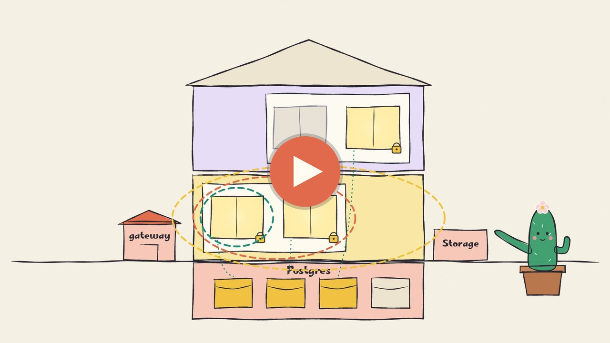
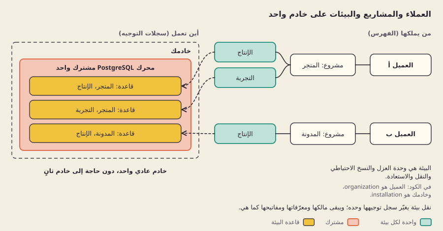
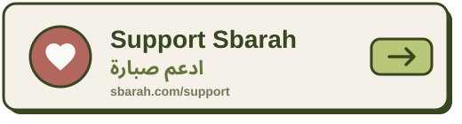

<p align="center"></p>

<h1 align="center">صباربيز</h1>

<p align="center" dir="rtl"><b>مشاريع Supabase كثيرة. خادم واحد.</b><br>Supabase الأصلي لكل عميل، على خادم تملكه.</p>

<p align="center" dir="rtl"><a href="README.md">English</a> · <a href="https://base.sbarah.com/">الموقع</a> · <a href="docs/README.ar.md">الوثائق</a> · <a href="docs/guides/quickstart.ar.md">البداية السريعة</a></p>

<p align="center" dir="rtl"><a href="https://base.sbarah.com/#explainer"></a><br><sub>دقيقة واحدة بصوت عربي: كيف يعمل صباربيز.</sub></p>

<div dir="rtl">

## ما هو

صباربيز طبقة مفتوحة المصدر تستضيفها بنفسك، تشغّل خدمات Supabase الأصلية (PostgreSQL وAuth وPostgREST وStorage) لمشاريع كثيرة على خادم واحد.

- **خادم عادي واحد.** لا تحتاج خادما ثانيا ولا خدمة سحابية. العملاء فيهم مشاريع، والمشاريع فيها بيئات (الإنتاج، التجربة).
- **لا تختلط البيانات.** لكل بيئة قاعدة بياناتها وحسابات دخولها ومفاتيحها. مفتاح مشروع لا يفتح مشروعا آخر أبدا.
- **موارد مشتركة.** يخدم محرك PostgreSQL واحد وعملية Storage واحدة البيئات في البنية الحالية. أما عدد المشاريع الذي يتحمله الخادم فيحتاج قياس الحمل، ولم نحدد له سعة إنتاجية.
- **المشروع المزدحم يستفيد من المكان الفارغ، لا من حصة جيرانه.** لكل بيئة حصة مضمونة في البوابة، ويمكن للمزدحمة أن تستعير ما لا يستخدمه غيرها. كل مشروع نشط في الدقيقة الأخيرة تبقى حصته كاملة له. وإن ظل مشروع يختنق، تصلك رسالة بالبريد أو خطاف الويب أو تيليجرام.
- **واجهات Supabase الأصلية.** يستخدم التطبيق supabase-js وSQL ضمن الميزات المدعومة. تفاصيل التوافق والفجوات في [الحالة](docs/reference/status.ar.md).

<p align="center"></p>

## إنشاء المشروع وأمان الدخول

ينشئ المشروع الجديد بيئة production ويجهزها تلقائياً، ثم يشغّل Studio الأصلي ويفتحه تلقائياً في تبويب جديد مع إبقاء النظام مفتوحاً. يلغي **Stay in console** الفتح التلقائي. للمشاريع الموجودة يبقى زر **Open Supabase dashboard**. تظهر صفحة Studio الأصلية كاملة دون شريط إضافي أو iframe. MFA مطلوب افتراضياً، ويمكن لمالك التثبيت جعله اختيارياً من **Account security** بعد التحقق برمز حديث. الحسابات التي فعّلت عاملاً تبقى مطالبة بالتحقق منه. راجع [دليل Studio](docs/guides/studio.ar.md) و[مصادقة الإدارة](docs/engineering/MANAGEMENT-MFA.ar.md) و[بحث تجربة المستخدم](docs/design/USER-JOURNEY.ar.md) و[الخطة المتكاملة](docs/engineering/plans/2026-10-10-management-project-workflow.md).

## التثبيت

على خادم Linux متوافق مع متطلبات Docker Engine وCompose والفحص المسبق، ثلاثة أوامر ([التثبيت عبر Docker](docs/guides/docker.ar.md)):

</div>

```bash
git clone https://github.com/M7MMAD-OMAR/sbarbase /opt/sbarbase && cd /opt/sbarbase
docker compose up -d --build
docker compose exec sbarbase python3 lab/bootstrap.py
```

<div dir="rtl">

المسار القديم للتثبيت خارج حاوية التحكم، على خادم Fedora فارغ (خطّط لأربع أنوية و8 GB). كل خطوة مشروحة في [البداية السريعة](docs/guides/quickstart.ar.md).

</div>

```bash
sudo dnf install -y moby-engine git python3-cryptography && sudo systemctl enable --now docker
sudo useradd -m sbarbase && sudo usermod -aG docker sbarbase && sudo install -d -o sbarbase -g sbarbase /opt/sbarbase && sudo -u sbarbase git clone https://github.com/M7MMAD-OMAR/sbarbase /opt/sbarbase
sudo -u sbarbase -H bash -c 'curl -fsSL https://bun.sh/install | bash -s bun-v1.3.14'
cd /opt/sbarbase && sudo -u sbarbase /usr/bin/python3 lab/operator_file.py /home/sbarbase/operator.json
sudo deploy/server-acceptance.sh --rehearse --install-unit --first-project --service-user sbarbase --home /home/sbarbase --bun-dir /home/sbarbase/.bun/bin --bootstrap-file /home/sbarbase/operator.json
```

<div dir="rtl">

الأمر الأخير يثبّت الخدمة، وينشئ أول مشروع، ويتأكد أن supabase-js يعمل من خلاله، وأن الخدمة تعود بعد إعادة تشغيل الخادم.

## الوثائق

| | |
|---|---|
| [الشروح](docs/README.ar.md) | لماذا وُجد وكيف بُني، مع رسوم توضيحية |
| [الأدلة العملية](docs/README.ar.md) | البداية السريعة، اختيار خادم، الترقيات، النسخ الاحتياطي والاستعادة |
| [المرجع](docs/README.ar.md) | المسرد والإعدادات وواجهة API والحالة |
| [القرارات](docs/decisions/README.ar.md) | ما اخترناه وما رفضناه ولماذا |
| [الأمان](SECURITY.ar.md) · [المساهمة](CONTRIBUTING.ar.md) · [سجل التغييرات](CHANGELOG.ar.md) | |

كل صفحة موجهة للقارئ متوفرة بالعربية والإنجليزية، وفي أعلاها رابط إلى اللغة الأخرى.

## الحالة

إصدار المصدر: 0.13.1. راجع [أحدث إصدار على GitHub](https://github.com/M7MMAD-OMAR/sbarbase/releases/latest) لمعرفة الإصدار المنشور وملفّات التنزيل التي اجتازت التحقق. أكّدت آليّة التحديث تشغيل المصدر `0044cb6` على خادم المالك في 2026-11-14؛ ولا يعني ذلك تثبيت إصدار عامّ برقم 0.13.0.

تستخدم اللوحة ألوان الأسطح لتمييز الارتفاع، مع تنقّل ثابت ومحدّدات مباشرة للمشروع والبيئة وقوائم تتّبع ألوان الواجهة وتبويبات تحمل اسم المشروع. ويظلّ Studio الأصليّ صفحة كاملة.

يعيد الإصدار 0.13.1 إتاحة التحديث من لوحة الإدارة للتثبيتات من 0.11.2 وما بعده: يحذف تصريح ترحيل PGMQ ويؤجّل إصلاح PGMQ إلى ما بعد نسخة احتياطيّة متحقّق منها تحفظ الطوابير القديمة ([الترقيات](docs/guides/upgrades.ar.md)).

يضيف الإصدار 0.13.0 رموزًا بصلاحيات محدّدة لواجهتَي API وMCP، وأرشفة المشاريع واستعادتها للمالك، واستعادة حساب المالك الوحيد بأمر محليّ بصلاحيّة root، وإصلاح التحقق من هويّة طلبات إدارة البيئة. ويصلح SMTP وتحميل القوالب والتخزين المؤقّت للملفات الخاصّة في صورة Studio المثبّتة، والتحقق من الإصدار مع اختلاف ترميز gzip. ولا تتغيّر صور الخدمات المثبّتة. تبقى الإزالة النهائيّة، والتأهيل الكامل لـ Storage، وزمن الاستجابة العامّ لـ Studio أعمالًا مفتوحة.

راجع [الحالة الحاليّة](docs/reference/status.ar.md) و[متطلّبات الترقية](docs/guides/upgrades.ar.md) و[دليل API وMCP](docs/guides/agents.ar.md). لا تدلّ بيانات نسخة التطوير أو بنود سجلّ التغييرات غير المنشورة على إصدار منشور أو مثبّت. ما زال القبول الإنتاجيّ الكامل مفتوحًا.

## الدعم

صباربيز مجاني ويُبنى بشكل مفتوح. إن كان مفيدًا لك، يمكنك دعم تطويره:

<a href="https://sbarah.com/support"><picture><source media="(prefers-color-scheme: dark)" srcset="docs/assets/support-sbarah-dark.svg"></picture></a>

أو [اشترِ لنا قهوة](https://www.buymeacoffee.com/m7mmadomar).

والإبلاغ عن شيء لا يعمل لا يقل قيمة عن ذلك؛ التفاصيل في [المساهمة](CONTRIBUTING.ar.md).

## الترخيص

Apache-2.0. تحتفظ Supabase وPostgreSQL والاعتماديات الأخرى بتراخيصها.

</div>
