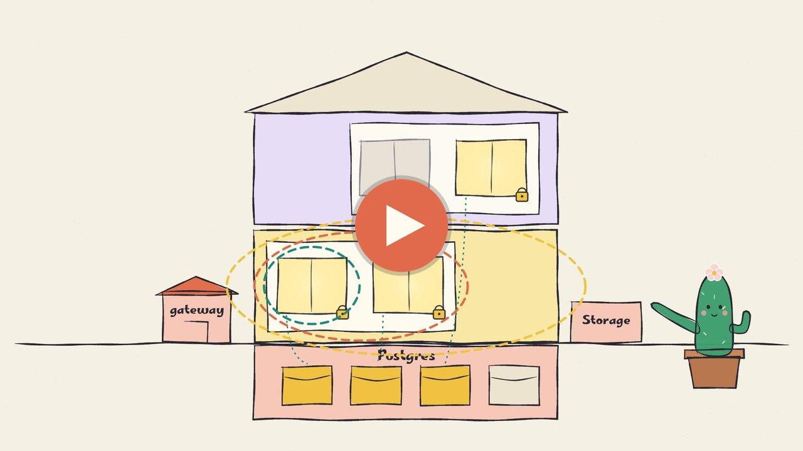
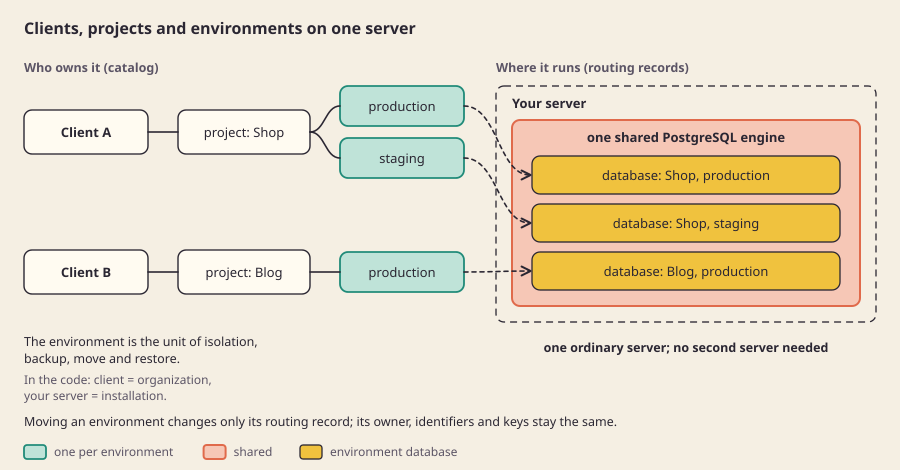

<p align="center"></p>

<h1 align="center">Sbarbase</h1>

<p align="center"><b>Many Supabase projects. One server.</b><br>Original Supabase for every client, on one machine you own.</p>

<p align="center"><a href="README.ar.md">العربية</a> · <a href="https://base.sbarah.com/en/">Website</a> · <a href="docs/README.md">Docs</a> · <a href="docs/guides/quickstart.md">Quickstart</a></p>

<p align="center"><a href="https://base.sbarah.com/en/#explainer"></a><br><sub>One minute, with voice: how Sbarbase works.</sub></p>

## What it is

Sbarbase is an open source, self-hosted layer that runs the original Supabase services (PostgreSQL, Auth, PostgREST, Storage) for many projects on one server.

- **One ordinary server.** No second machine and no cloud service needed. Clients hold projects, projects hold environments (production, staging).
- **No data mixing.** Each environment has its own database, its own logins and its own keys. A key from one project never opens another.
- **Shared resources.** The existing topology shares PostgreSQL and Storage across environments. Capacity depends on measured workloads; no fixed project count is validated.
- **A busy project uses the free room, never its neighbours' share.** Each environment has a guaranteed share of the gateway, and a busy one may borrow what the others are not using. Every project that was active in the last minute keeps its whole share. If one keeps choking, you get a message by email, webhook or Telegram.
- **Original Supabase APIs.** Tested workflows use supabase-js and SQL. Full cloud feature compatibility remains a development goal.

<p align="center"></p>

## Install

On a compatible Linux host with rootful Docker Engine and Compose, three commands ([Install with Docker](docs/guides/docker.md)):

```bash
git clone https://github.com/M7MMAD-OMAR/sbarbase /opt/sbarbase && cd /opt/sbarbase
docker compose up -d --build
docker compose exec sbarbase python3 lab/bootstrap.py
```

The earlier native supervisor installation path, on an empty Fedora server (plan on 4 cores and 8 GB). Each step is explained in the [quickstart](docs/guides/quickstart.md).

```bash
sudo dnf install -y moby-engine git python3-cryptography && sudo systemctl enable --now docker
sudo useradd -m sbarbase && sudo usermod -aG docker sbarbase && sudo install -d -o sbarbase -g sbarbase /opt/sbarbase && sudo -u sbarbase git clone https://github.com/M7MMAD-OMAR/sbarbase /opt/sbarbase
sudo -u sbarbase -H bash -c 'curl -fsSL https://bun.sh/install | bash -s bun-v1.3.14'
cd /opt/sbarbase && sudo -u sbarbase /usr/bin/python3 lab/operator_file.py /home/sbarbase/operator.json
sudo deploy/server-acceptance.sh --rehearse --install-unit --first-project --service-user sbarbase --home /home/sbarbase --bun-dir /home/sbarbase/.bun/bin --bootstrap-file /home/sbarbase/operator.json
```

The last command installs the service, creates a first project, proves supabase-js works through it and checks that the service comes back after a reboot.

## Project setup and sign-in

New projects automatically create and provision a production environment, then start and open the original Supabase Studio in a new tab while keeping the console open. Choose **Stay in console** to cancel automatic opening. Existing projects retain **Open Supabase dashboard**. Studio opens as its original full page, without an added navigation bar or iframe. Management MFA is required by default; the installation owner can make it optional with a fresh authenticator verification under **Account security**. Enrolled accounts still verify MFA. See [Studio](docs/guides/studio.md), [management MFA](docs/engineering/MANAGEMENT-MFA.md), the [UX research and journey audit](docs/design/USER-JOURNEY.md) and the [complete implementation plan](docs/engineering/plans/2026-10-10-management-project-workflow.md).

## Documentation

| | |
|---|---|
| [Explanations](docs/README.md#explain-why-it-works-this-way) | why it exists and how it is built, with diagrams |
| [Guides](docs/README.md#guides-how-to-do-something) | quickstart, choosing a server, upgrades, backup and restore |
| [Reference](docs/README.md#reference-facts-to-look-up) | glossary, configuration, API, status |
| [Decisions](docs/decisions/README.md) | what was chosen, what was rejected, and why |
| [Security](SECURITY.md) · [Contributing](CONTRIBUTING.md) · [Changelog](CHANGELOG.md) | |

Reader guides and references are in English and Arabic. The dated engineering notebook is primarily in English. See the [project layout](docs/reference/project-layout.md) for the repository structure.

## Status

The current version is 0.3.2 ([changelog](CHANGELOG.md)). It runs on a real server with up to eight environments, encrypted off-site backups whose restore was tried there, and notifications by Telegram. Docker install and VM rehearsals have scoped passing evidence. Production acceptance remains open. What works, with every number, is in [status](docs/reference/status.md).

Current work is the [upstream currency plan](docs/engineering/plans/2026-10-14-upstream-currency.md); longer-term priorities are in the [product and portability plan](docs/engineering/plans/2026-10-03-product-and-portability-plan.md), with the [execution contract](docs/engineering/plans/2026-10-03-gauntlet-execution-method.md) defining how each claim is verified.

## Support

Sbarbase is free and built in the open. If it is useful to you, you can support its development:

<a href="https://www.buymeacoffee.com/m7mmadomar"></a>

A report of something that does not work is worth as much; see [Contributing](CONTRIBUTING.md).

## License

Apache-2.0. Supabase, PostgreSQL and other dependencies keep their own licenses.
