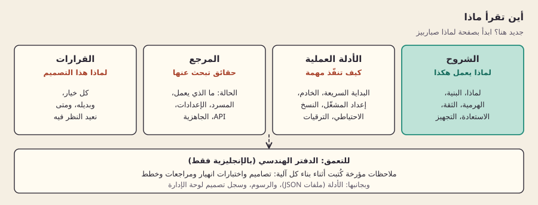

[English](README.md)

# وثائق صباربيز

صباربيز يشغّل مشاريع Supabase كثيرة على خادم واحد، ويوفر إجراءات للنسخ الاحتياطي والاستعادة والترقية، لكل منها نطاق تحقق وحدود موثقة. قسّمنا الوثائق بحسب ما تحتاجه الآن. ابدأ بصفحة [لماذا](explain/why.ar.md) إن كنت جديدًا، أو بصفحة [الحالة](reference/status.ar.md) إن أردت معرفة ما يعمل.

*أربعة أقسام، لكل منها غرض واحد، وتحتها الدفتر الهندسي.*

كلمات تتكرر في كل الصفحات: **العميل** (يسمّى منظمة في الكود) يملك **مشاريع**، ولكل مشروع **بيئات** مثل الإنتاج والتجربة. و"خادمك" هو ما يسمّيه الكود التثبيت. البيئة هي وحدة العزل والنقل والاستعادة. المصطلحات غير المألوفة في [المسرد](reference/glossary.ar.md).

## الشروح: لماذا يعمل بهذه الطريقة

اقرأ هذه الصفحات لتفهم التصميم. لكل صفحة الشكل نفسه: ما هو، ولماذا، وكيف بنيناه، وحدوده، وأين تتعمق أكثر.

- [لماذا صباربيز](explain/why.ar.md): المشكلة، والبدائل الموجودة، وما المختلف هنا.
- [البنية](explain/architecture.ar.md): مسار الطلب، وما هو مشترك وما هو منفصل.
- [الهرمية](explain/hierarchy.ar.md): العملاء والمشاريع والبيئات، ولماذا تنفصل الملكية عن مكان التشغيل.
- [العزل والثقة](explain/isolation-and-trust.ar.md): ما الذي يشكّل نقطة فشل مشتركة، ومن الموثوق.
- [نموذج التهديد](explain/threat-model.ar.md): الأصول، والمهاجمون، وحدود الثقة، والفحص وراء كل إجراء وقائي، والثغرات المعروفة.
- [الاستعادة](explain/recovery.ar.md): السياج، ثم التصدير، ثم الاستعادة، ثم التحقق، ثم التحويل.
- [التجهيز](explain/provisioning.ar.md): لماذا لا يؤدي الانهيار أبدًا إلى تنفيذ العمل مرتين.

## الأدلة العملية: كيف تنفّذ مهمة

- [التثبيت عبر Docker](guides/docker.ar.md): طريقة التثبيت الأساسية، من جهاز Ubuntu 26.04 فارغ حتى تعمل لوحة الإدارة، كما جُرّبت في آلة افتراضية محلية.
- [البداية السريعة](guides/quickstart.ar.md): التثبيت دون Docker، من خادم فارغ إلى استدعاء supabase-js، كما جُرّب في آلة افتراضية محلية.
- [اختيار خادم](guides/choosing-a-server.ar.md): ماذا تشتري، وماذا تعطيك الخيارات المجانية فعلًا.
- [المختبر المحلي](guides/local-lab.ar.md): شغّل الحزمة على جهازك لتقييمها.
- [إعداد المشغّل](guides/operator-setup.ar.md): أنشئ المشغّل الأول والعميل الأول.
- [النشر على خادم](guides/server-deployment.ar.md): دليل تشغيل الخادم وثغراته المعروفة.
- [Realtime](guides/realtime.ar.md): تغييرات قاعدة البيانات والبث والحضور لكل بيئة.
- [واجهة البيانات](guides/data-api.ar.md): اكشف مخططاتك الخاصة عبر PostgREST، مع الصلاحيات التي تحتاجها.
- [المهام المجدولة](guides/scheduled-jobs.ar.md): الدالتان `cron.schedule` و`net.http_*` لكل بيئة، والقاعدة التي تتبعها الطلبات الصادرة.
- [النقل من Supabase](guides/move-from-supabase.ar.md): انسخ مشروع Supabase ومستخدميه وملفاته إلى بيئة جديدة بأمر واحد.
- [الوصول إلى قاعدة البيانات](guides/database-access.ar.md): سلسلة اتصال PostgreSQL لكل بيئة للترحيلات وpsql وأدوات ORM.
- [وكلاء الذكاء الاصطناعي والواجهة البرمجية](guides/agents.ar.md): رموز الوصول ونقطة MCP والواجهة المتوافقة مع Supabase، ليستطيع Claude Code أو Cursor أو Codex النشر هنا.
- [مفاتيح API](guides/api-keys.ar.md): مفاتيح عامة للتطبيقات، ومفاتيح سرية (`service_role`) للخوادم والوكلاء.
- [مفتاح التوقيع](guides/signing-keys.ar.md): غيّر مفتاح توقيع JWT لبيئة متى احتمل أنه تسرّب.
- [Edge Functions](guides/edge-functions.ar.md): انشر مجلد دوال Supabase إلى بيئة واستدعِه عبر supabase-js.
- [السجلات والمقاييس](guides/logs-and-metrics.ar.md): الطلبات والأخطاء وأزمنة الاستجابة وسجلات الخدمات لكل بيئة.
- [إعدادات تسجيل الدخول](guides/sign-in.ar.md): عنوان الموقع وعناوين إعادة التوجيه ومزوّدو OAuth (Google وGitHub وApple وغيرها) لكل بيئة.
- [المصادقة في لوحة الإدارة](guides/authentication.ar.md): جولة بلقطات شاشة في كل صفحات المصادقة، من المزوّدين إلى سجلات التدقيق.
- [جولة في لوحة الإدارة](guides/console-tour.ar.md): كل أقسام البيئة في لوحة الإدارة ومتى تستعمل كل قسم.
- [Supabase Studio](guides/studio.ar.md): افتح Studio الأصلي لبيئة واحدة، من خلف تسجيل الدخول إلى الواجهة، عبر نفق SSH أو على عنوانه العام.
- [النسخ الاحتياطي والاستعادة](guides/backup-and-restore.ar.md): النسخ اليومي والاستعادة والنسخ المشفّرة خارج الخادم وحدود كل إجراء.
- [إيقاف الكتابة](guides/write-pause.ar.md): إيقاف كتابات التطبيقات في بيئة واحدة قبل أي عمل يكون طريق العودة منه استعادة نسخة احتياطية.
- [الترقيات](guides/upgrades.ar.md): التحديث من لوحة الإدارة، والتحديث التلقائي الاختياري، وسطر الأوامر، مع عودة تلقائية إن فشل. وما تفعله أعمال الترقية وأين تقف: [الحدود المعروفة](engineering/upgrades-known-limits.md) (بالإنجليزية).
- [الأمر sbarbase](guides/cli.ar.md): الحالة والنسخ الاحتياطية والاستعادة والبيئات والمفاتيح والترقية وStudio والسجلات من أمر واحد.

## المرجع: حقائق تبحث عنها

- [الحالة](reference/status.ar.md): المكان الوحيد لما يعمل ولكل رقم، مع التواريخ والأوامر.
- [المسرد](reference/glossary.ar.md): كل مصطلح داخلي في جملة أو جملتين.
- [الإعدادات](reference/configuration.ar.md): الملفات والخيارات ومتغيرات البيئة التي يتعامل معها المشغّل.
- [واجهة API](reference/api.ar.md): مسارات الإدارة والبوابة.
- [جاهزية النشر](reference/deployment-readiness.ar.md): مصفوفة جاهزية الخادم بندًا بندًا.
- [تصميم لوحة الإدارة](reference/console-design.ar.md): رموز تصميم Supabase في لوحة الإدارة، والتنقل فيها، ولقطة الخادم.

- [هيكل المستودع](reference/project-layout.ar.md): مجلدات الكود والوثائق والفحوص، وما يرجع إليه العمل الحالي.

## اتجاه العمل الآن

يعتمد المشروع على خدمات Supabase الأصلية، ويهدف إلى تسهيل تشغيلها وإدارتها وتخصيصها على Linux عبر Docker. العمل النشط هو [خطة مواكبة الإصدارات الأصلية](engineering/plans/2026-10-14-upstream-currency.ar.md)، ويعمل خادم حقيقي على v0.7.1، ثُبّت عبر قناة التحديث ([الحالة](reference/status.ar.md)). تسجّل [أهداف المشروع](../PROJECT_GOAL.md) المتطلبات، وتحدد [خطة المنتج وقابلية التشغيل](engineering/plans/2026-10-03-product-and-portability-plan.md) الأولويات. وتربط [طريقة التنفيذ والتحقق](engineering/plans/2026-10-03-gauntlet-execution-method.md) كل نتيجة بنطاقها، مع [عقد مكان التشغيل الأصلي](engineering/plans/2026-10-03-native-placement-identity.md) و[سجل الأدلة](engineering/gauntlet-ledger.json).

## القرارات

- [سجل القرارات](decisions/README.ar.md): كل اختيار، والبديل عنه، وشروط إعادة النظر فيه.

## الدفتر الهندسي

يضم [docs/engineering](engineering/README.md) الملاحظات المفصلة التي كُتبت أثناء بناء كل آلية: التصاميم، واختبارات الانهيار، والمراجعات، والخطط، و[نقاط التحقق](engineering/checkpoints.md) بترتيبها الزمني. هي دقيقة ومؤرخة، وبعضها حلّت محله ملاحظات لاحقة. اقرأها حين تحيلك إليها صفحة شرح، أو قبل أن تغيّر ذلك الجزء من النظام. ملاحظات الوكلاء البرمجيين الذين يكملون العمل في [engineering/handoff](engineering/handoff/README.md).

ونحتفظ هنا أيضًا بـ[الأدلة](evidence/) (ملفات JSON تكتبها الفحوص الحية وتستشهد بها صفحة الحالة)، و[الرسوم التوضيحية](diagrams/README.md)، و[سجل تصميم لوحة الإدارة](design/CONSOLE.ar.md).
