[العربية](authentication.ar.md)

# Authentication in the console

Every environment has its own Authentication workspace. This page walks it in the order the console shows it, so you can follow it with the console open and know what to click next. The screenshots come from the console's test pages with example data (`example.com` addresses and made up names), not from a real installation, and every caption says so. Numbers on a screenshot mark where to click, in order.

Open the environment, then **Sign-in settings**. Only owners and admins see it. Everything on it belongs to this environment alone: another environment's providers and secrets never appear here.

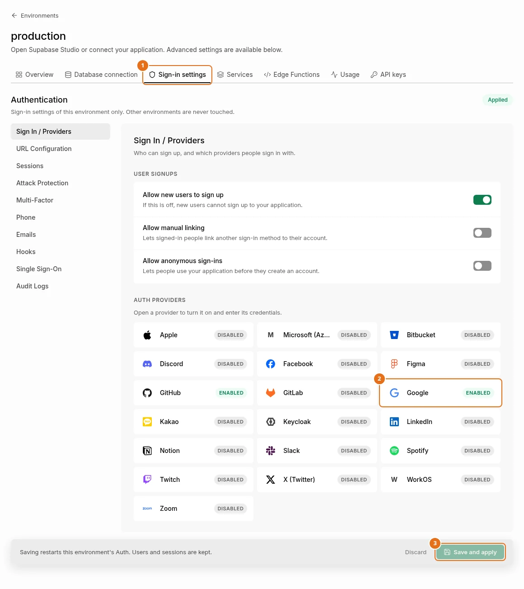

*Demo data. The page menu is on the left, the settings of the chosen page on the right, and one save bar at the bottom.*

Reference detail (why a setting is missing, what was tried on a running Auth, how a save is protected) is in [Sign-in settings](sign-in.md). This page is the walkthrough.

## Before you start

1. Give the server its public address once, so callback and email links are not `http://localhost` ([step 1 of Sign-in settings](sign-in.md#1-give-the-server-its-public-address)).
2. Know which pages save by themselves. **Sign In / Providers**, **URL Configuration**, **Sessions**, **Attack Protection**, **Multi-Factor**, **Hooks**, **Single Sign-On** and **Audit Logs** are saved together by the bar at the bottom (**Save and apply**). **Emails** (SMTP Settings and Templates) and **Phone** have their own **Save changes** button, and the bar is hidden there. Adding or removing a single sign-on provider acts at once.
3. Saving restarts this environment's Auth. People who are signed in stay signed in; users and sessions are kept.

## What "Applied" and "Not applied" mean

The chip at the top right of the workspace is the state of the last save.

| Chip | Meaning | What to do |
|---|---|---|
| **Default settings** | Nothing was ever saved here. Auth runs with the pinned defaults. | Change a setting and save. |
| **Applying…** | Auth is restarting with your save. A few seconds. | Wait. The page checks again by itself. |
| **Applied** | Auth started with the saved settings. | Test it. **Applied does not prove that a provider, SMTP relay or SMS service accepts your credentials.** Sign up once to check. |
| **Not applied** | Auth did not start with the new settings. The previous Auth keeps running, so nobody is locked out. The reason is shown under the page title. | Fix the reason, then press **Save and apply** again. The button stays available on purpose. |

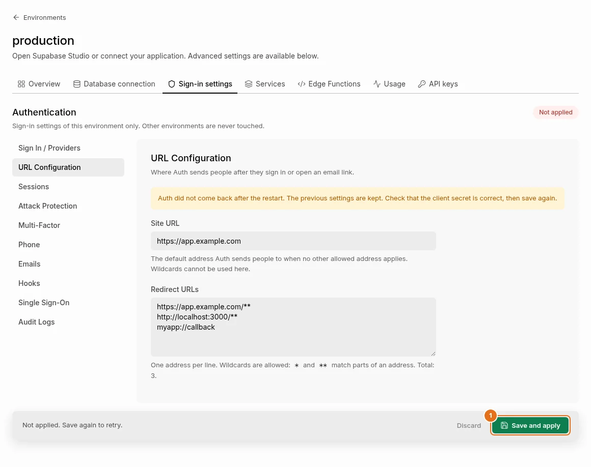

*Demo data. The reason text in this screenshot is an example; your own reason comes from your Auth.*

Two refusals you may meet: "Wait a few seconds before saving again" (a second save within 10 seconds of the last state change, because each save restarts Auth) and "These settings changed since you opened them" (someone else saved first; reload and save again).

## 1. Sign In / Providers

**What it is for:** who may sign up, and which providers people sign in with.

**User signups** has three switches: **Allow new users to sign up**, **Allow manual linking** (signed-in people may link another sign-in method) and **Allow anonymous sign-ins**. Turning the first off means nobody new can register at all.

**Auth providers** lists Apple, Microsoft (Azure), Bitbucket, Discord, Facebook, Figma, GitHub, GitLab, Google, Kakao, Keycloak, LinkedIn, Notion, Slack, Spotify, Twitch, X (Twitter), WorkOS and Zoom, each with its logo (Microsoft and WorkOS show a letter) and an **Enabled** or **Disabled** badge. After a failed **Save and apply**, a provider whose fields have an error (a missing client ID or secret, a space in a value, an invalid server address) is marked **Needs attention**, and the save is refused until you fix it.

### The provider panel

Click a provider to open its panel. The fields that matter:

| Field | What to put there |
|---|---|
| **Enable Sign in with ...** | The switch that turns the provider on for this environment only. |
| **Client ID** (**Client IDs** for Google) | From the provider. Google takes a comma separated list (web, Android, iOS, One Tap, Chrome extensions). |
| **Client secret** | From the provider. **Never shown again** once saved: the field then reads "Saved. Leave empty to keep it." Type a new one only to replace it. |
| **Server address** | Only for providers that name their own server. Keycloak requires it; Microsoft (Azure), GitLab and WorkOS take one when you run your own. |
| **Skip nonce checks** | Apple and Google only. Less secure; use it only when you cannot get the nonce, as on iOS. |
| **Allow users without an email** | For providers that may not return an address. |
| **Callback URL (for OAuth)** | Read only, with a **Copy** button. **This is the one value you copy out of the console** and register at the provider. |

**Remove saved credentials** (red) removes the saved client ID and secret of that provider when you save. **Done** closes the panel; nothing is saved until **Save and apply**.

### Example: Google

1. Open **Google** and press **Copy** next to **Callback URL (for OAuth)**.
2. In the Google Cloud console, open APIs & Services, then Credentials, then create an OAuth client ID of type Web application. Paste the callback address under authorized redirect URIs.
3. Copy the client ID and client secret Google shows into the panel, turn on **Enable Sign in with Google**, press **Done**, then **Save and apply**.

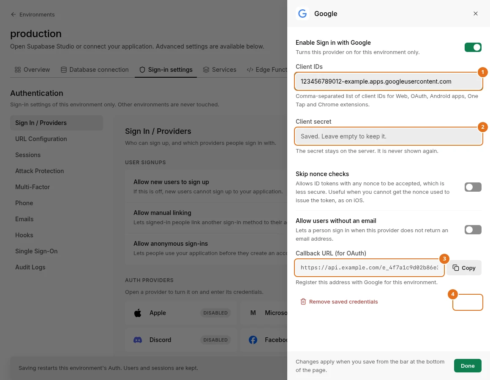

*Demo data. The secret field shows "Saved. Leave empty to keep it." because a secret is already stored.*

### Example: GitHub

1. Open **GitHub** and copy the **Callback URL (for OAuth)**.
2. In GitHub, open Settings, Developer settings, OAuth Apps, then register a new OAuth App. Paste the callback address as the authorization callback URL.
3. Paste the client ID and a generated client secret into the panel, turn the switch on, press **Done**, then **Save and apply**.

### Example: Microsoft (Azure)

1. Open **Microsoft (Azure)** and copy the **Callback URL (for OAuth)**.
2. In Microsoft Entra, register an application, add the callback address as a Web redirect URI, and create a client secret. Microsoft shows the secret value once, so copy it then.
3. Paste the application (client) ID and the secret into the panel. **Server address (optional)** can stay empty; fill it only to limit sign-in to one Microsoft tenant, using the tenant address from Microsoft. Test that sign-in with your tenant before you rely on it.
4. Turn the switch on, press **Done**, then **Save and apply**.

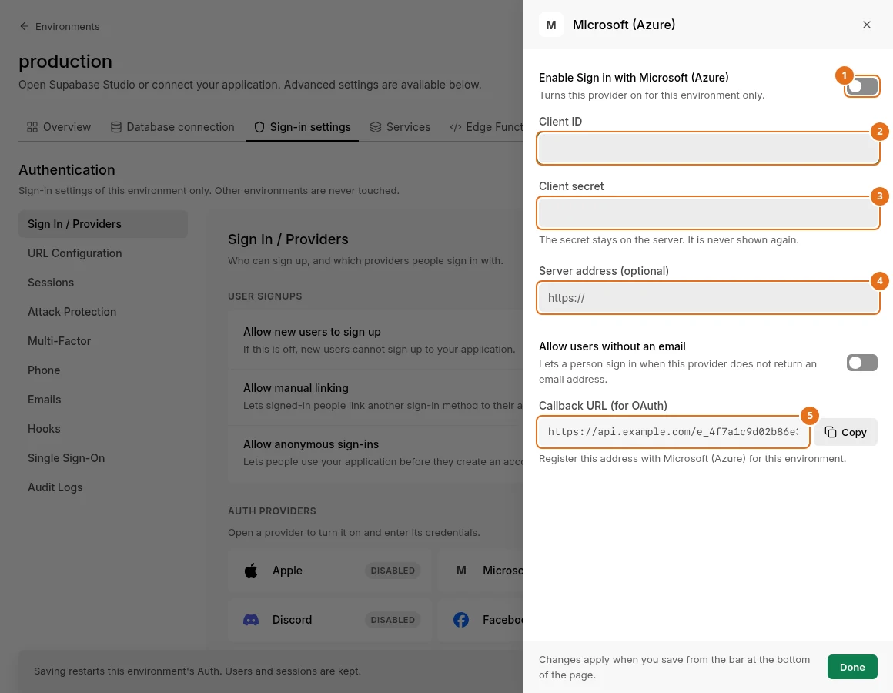

*Demo data. An empty panel is what you see the first time.*

In your application the call is the usual one:

```js
await supabase.auth.signInWithOAuth({ provider: 'google', options: { redirectTo: 'https://app.example.com/welcome' } })
```

**Be careful:** the secret cannot be read back. If you lose it, create a new one at the provider and paste it. A provider turned on without its secret is refused by the page before it reaches Auth.

## 2. URL Configuration

**What it is for:** where Auth sends people after they sign in or open an email link.

- **Site URL**: your application's address, for example `https://app.example.com`. The default landing address. Write one plain address here; patterns belong in **Redirect URLs**.
- **Redirect URLs**: the other addresses Auth may send people to, one per line, up to 50, each with a scheme (`https://`, or `myapp://` for a mobile app) and no spaces or commas. `*` and `**` match parts of an address, so `https://app.example.com/**` allows the whole site.

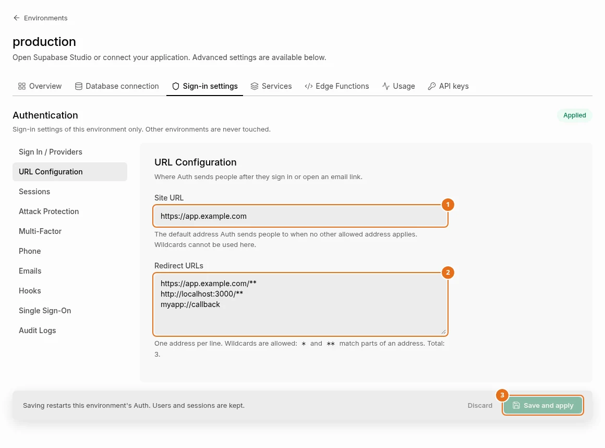

*Demo data.*

**Be careful:** a redirect address that is wider than you need lets a sign-in link send people to a page you do not control. Keep the list as narrow as your application allows, and keep `http://localhost:3000/**` only while you develop.

## 3. Sessions

**What it is for:** how long a person stays signed in.

| Field | Range | Empty means |
|---|---|---|
| **Access token expiry time (seconds)** | 60 to 86400 | Auth's own default, 3600 seconds. The client refreshes the token, so this does not sign anyone out. |
| **Time-box user sessions (hours)** | 1 to 87600 | No limit: a session does not end because of its age. |
| **Inactivity timeout (hours)** | 1 to 87600 | No limit: an idle session does not end. |
| **Enforce single session per user** | switch | Off: a person may be signed in on several devices. On: only the most recently active session survives. |

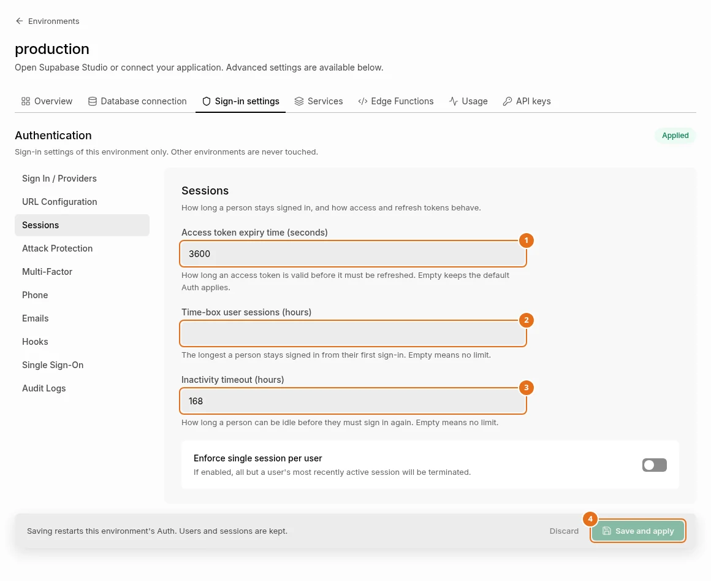

*Demo data. Here the inactivity timeout is 168 hours (7 days) and the time-box is empty.*

A new limit applies to sessions started after the save; a session already running keeps the lifetime it started with. The hour fields take whole hours, not parts of an hour.

## 4. Rate limits

**What it is for:** stopping one visitor from using up your email or SMS quota. The console has no separate Rate Limits page; the limits sit next to the thing they limit.

- **Emails** has the email limits: emails per hour, sign-in email requests and token verifications per 5 minutes (counted for the whole environment, not per visitor), and the minimum seconds between two emails to one person. See [Emails](#8-emails).
- **Phone** has **Rate limit for sending SMS (messages/h)**, from 1 to 1000000, across all numbers. It also bounds what your SMS provider can bill you. See [Phone](#7-phone).

Limits for token refreshes, anonymous sign-ins and Web3 are not offered: Auth applies them per client address, and the gateway does not pass a trusted client address to it yet.

## 5. Attack Protection

**What it is for:** passwords that are easy to guess.

- **Prevent use of leaked passwords**: refuses passwords found in known leaks. Auth asks the public Have I Been Pwned range service, so this environment's Auth gets outbound network access while the switch is on.
- **Minimum password length**: 6 to 72 characters. Auth hashes at most 72 bytes of a password, so 72 is the highest value.

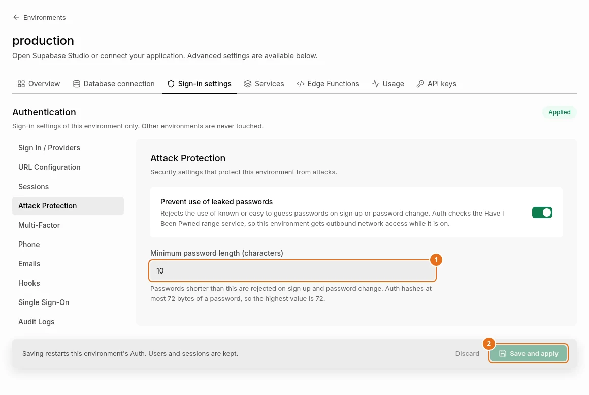

*Demo data.*

The captcha setting of the Supabase cloud is not offered here.

## 6. Multi-Factor

**What it is for:** a second step (an authenticator app, TOTP) for the people who use your application. It is separate from the operator's own two-step sign-in to the console, which is under Account security.

- **Allow people to add an authenticator app (TOTP)** and **Allow people to verify with an authenticator app (TOTP)**: both on by default.
- **Maximum number of per-user MFA factors**: 1 to 30.

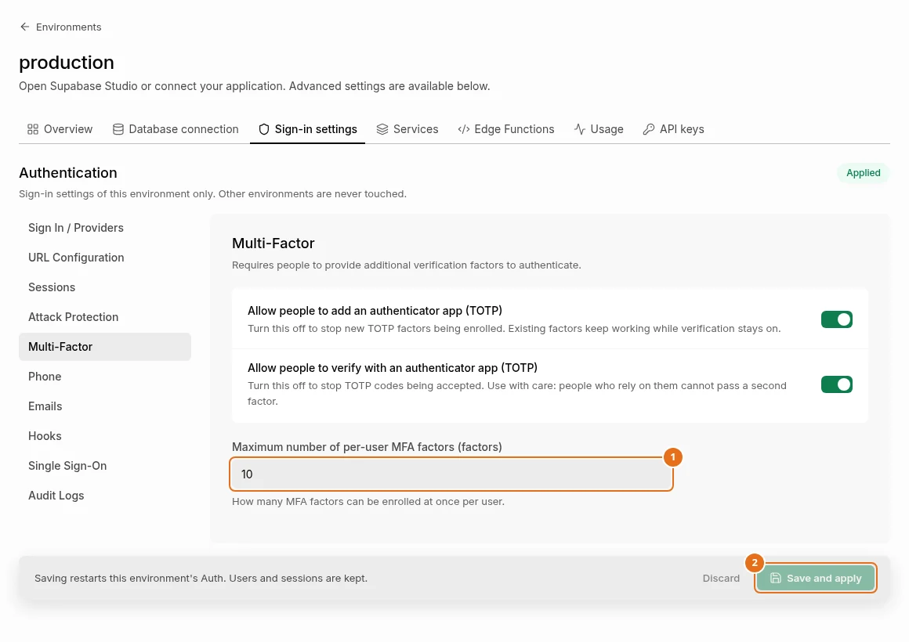

*Demo data.*

**Be careful:** turning off verification stops TOTP codes being accepted, so people who rely on them cannot pass the second step. Turning off enrollment leaves existing factors working.

## 7. Phone

**What it is for:** sign-up and sign-in with a phone number and an SMS code.

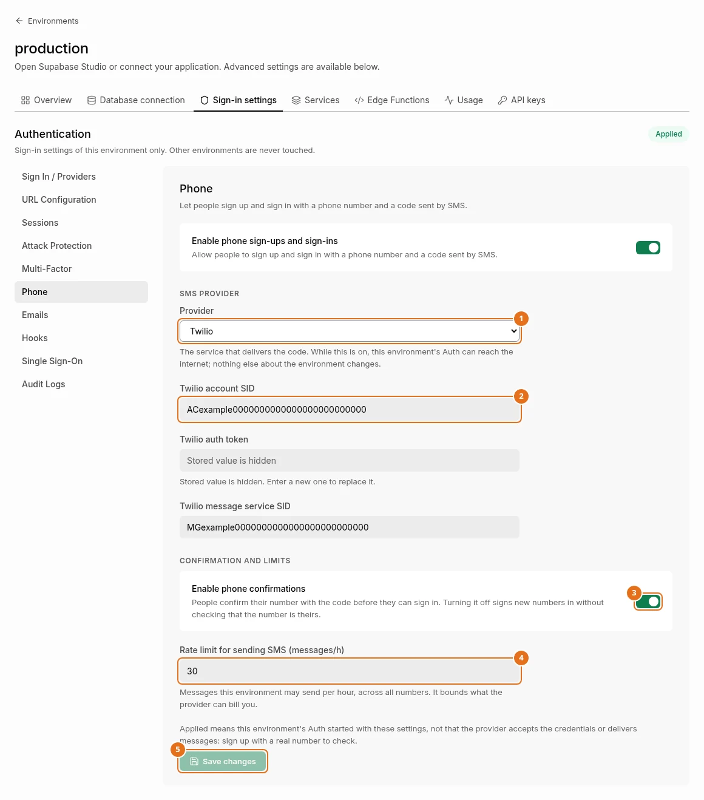

*Demo data. The account SID is an example value.*

Turn on **Enable phone sign-ups and sign-ins**, pick a **Provider** (Twilio, Twilio Verify, MessageBird, Textlocal or Vonage), fill the credentials the page then shows, and press **Save changes**.

- **A credential marked secret is never shown again** ("Stored value is hidden").
- Changing the provider needs that provider's own credentials; the old ones are not carried over.
- **Enable phone confirmations** is on by default. **Be careful:** turned off, new numbers are signed in without checking that the number is theirs.
- While phone sign-in is on, this environment's Auth can reach the internet, because every provider is an HTTPS service.
- **Applied does not mean a message was delivered.** Sign up with a real number to check.

## 8. Emails

**What it is for:** the emails Auth sends (sign-up confirmation, magic link, password reset). It has two sub pages, **SMTP Settings** and **Templates**.

### SMTP Settings

Turn on **Enable custom SMTP**, then fill **Sender email address**, **Sender name**, **Host**, **Port number** (465 or 587 are usual; avoid 25), **Username** and **Password**, and press **Save changes**.

- **The password is never shown again.** A saved one reads "Stored password is hidden. Enter a new password to replace it." Leave the field empty to keep it.
- **Without custom SMTP, no email is sent**, and new sign-ups are confirmed automatically.
- With custom SMTP on, new sign-ups must confirm their email address; people who signed up before are not affected.
- Turning the switch off and saving removes the stored SMTP settings and password, and Confirm email and the mail limits go back to their defaults.
- **Applied** means Auth started with the settings. It does not mean your SMTP provider accepts them. Send a test sign-up.

**Confirm email** and the mail limits are on the Emails page (today under **Confirmation and limits** in SMTP Settings, shown while custom SMTP is on). **Be careful with Confirm email:** turned off, new sign-ups are not checked against the address they give, so anyone can register an address that is not theirs, and Auth no longer applies the hourly email limit.

### Templates

Open **Templates** to edit the six messages: Confirm sign up, Invite user, Magic link, Change email address, Reset password and Reauthentication. Each has a **Subject heading** and an HTML body, a **Source** and a **Preview** view, and a list of the variables Auth fills in, such as `{{ .ConfirmationURL }}` and `{{ .Token }}`. **Reset to default** brings back Supabase's own text.

- A template is delivered only while custom SMTP is on. The page says so when it is off.
- A subject is one line of at most 200 bytes, a body at most 32 KiB, and every `{{` needs its `}}`. The page refuses unpaired braces before you save, and the server can still refuse a malformed template with a message when you save.
- Auth fetches the message from the console, and keeps a body in memory after the first fetch, which is why every save restarts Auth. A host firewall that blocks that route makes Auth fall back to its own text even though the chip says **Applied**; send a test message to be sure.

## 9. Hooks

**What it is for:** running your own Postgres function at set points of Auth. The seven hooks are Customize Access Token (JWT) Claims, Send Email, Send SMS, MFA Verification Attempt, Password Verification Attempt, Before User Created and After User Created.

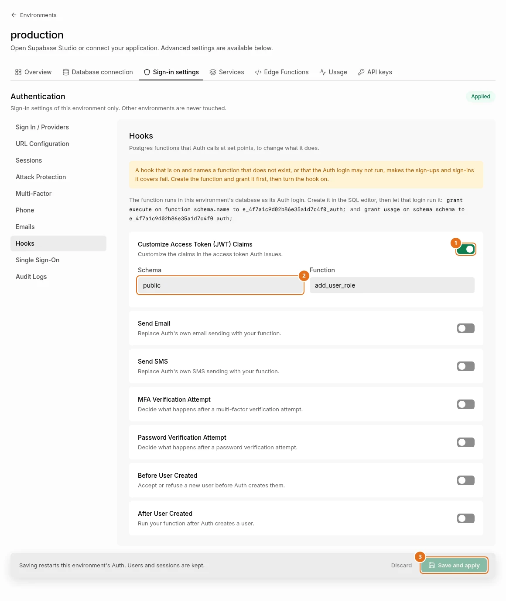

*Demo data. add_user_role is an example function name.*

1. Create the function in this environment's database (in the SQL editor).
2. Run the two `grant` lines the page shows, so Auth's own login may run it.
3. Only then turn the hook on, type the **Schema** and **Function**, and **Save and apply**.

**Be careful:** a hook that is on and names a function that does not exist, or that the Auth login may not run, makes the sign-ups and sign-ins it covers fail. Create and grant first, then turn the hook on, and test it before you leave it on. Only Postgres function hooks are offered.

## 10. Single Sign-On

**What it is for:** letting people sign in through their company's SAML 2.0 identity provider.

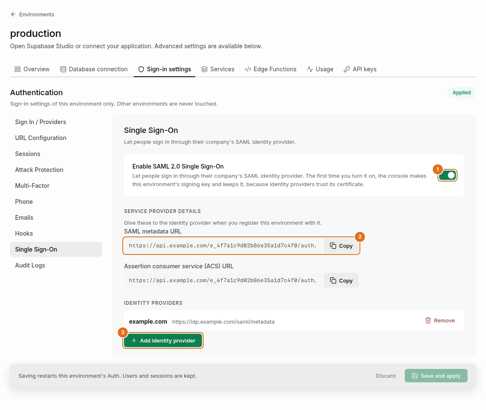

*Demo data. example.com is the company domain of the example provider.*

1. Turn on **Enable SAML 2.0 Single Sign-On** and press **Save and apply**. The first time, the console makes this environment's signing key and keeps it.
2. Copy the **SAML metadata URL** and the **Assertion consumer service (ACS) URL** and register them in the identity provider.
3. Download the provider's metadata XML, press **Add identity provider**, paste it into **Metadata XML**, enter the **Domains** whose people it serves, and press **Add provider**. A web address for the metadata is not fetched: paste the XML.
4. In your application, call `signInWithSSO` with the person's email domain.

**Be careful:** once a provider is removed, its people can no longer sign in through it. If the signing key file is removed on the host, a new key is made and every identity provider must be given the new certificate.

## 11. Audit Logs

**What it is for:** seeing what Auth recorded: sign-ins, sign-ups, token refreshes and account changes, newest first, 50 to a page, with who, what, the IP address and when.

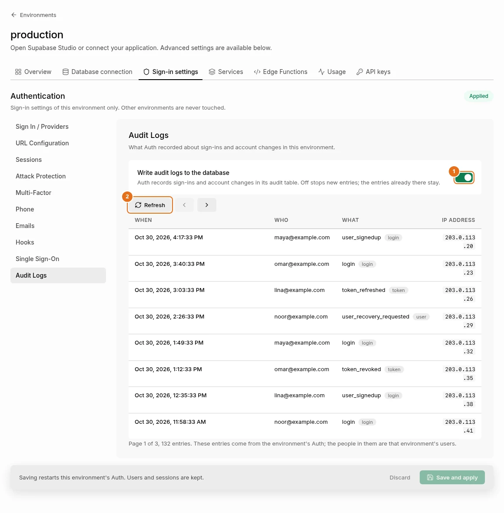

*Demo data. The people and addresses are made up.*

The list comes from Auth's own admin API, so database access does not need to be on. The switch **Write audit logs to the database** controls whether new entries are recorded: off stops new entries and keeps the old ones.

## Dark theme

The console follows the system theme and has a theme button in the sidebar. Everything above looks the same in dark.

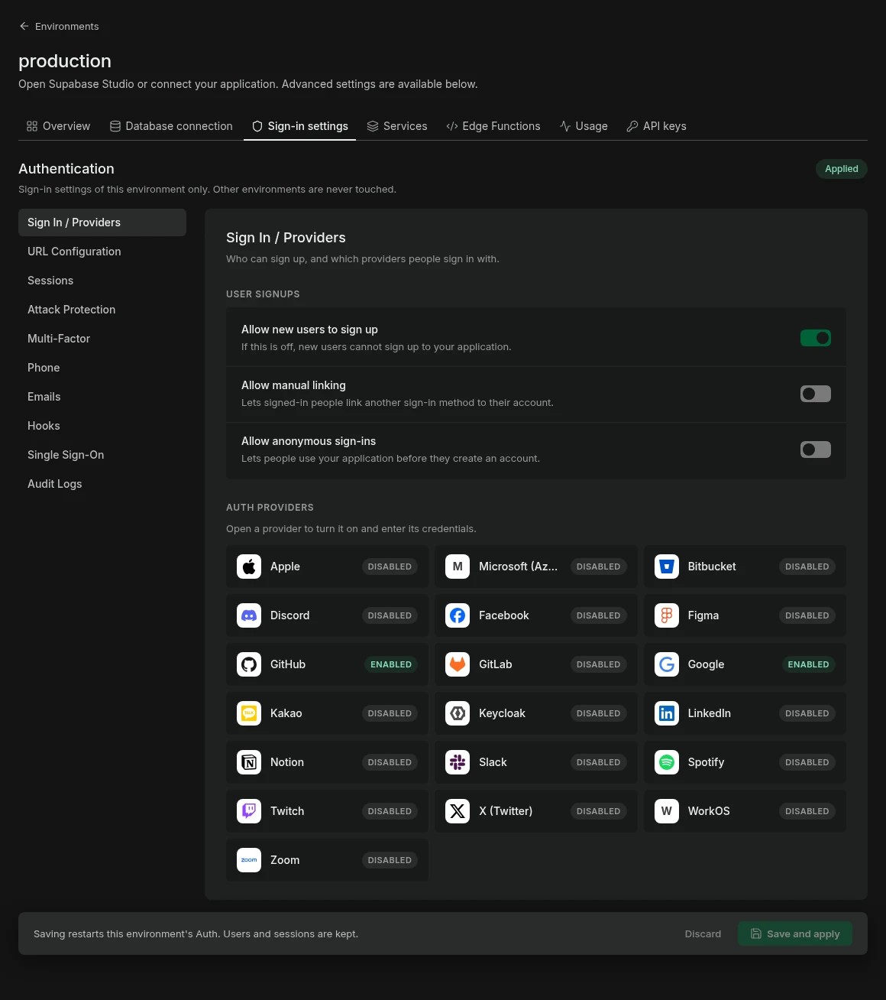

*Demo data.*

## Right to left

The console's text is English only for now and does not switch to Arabic by itself, but its layout is built to mirror. This is what the page looks like when it is shown right to left.

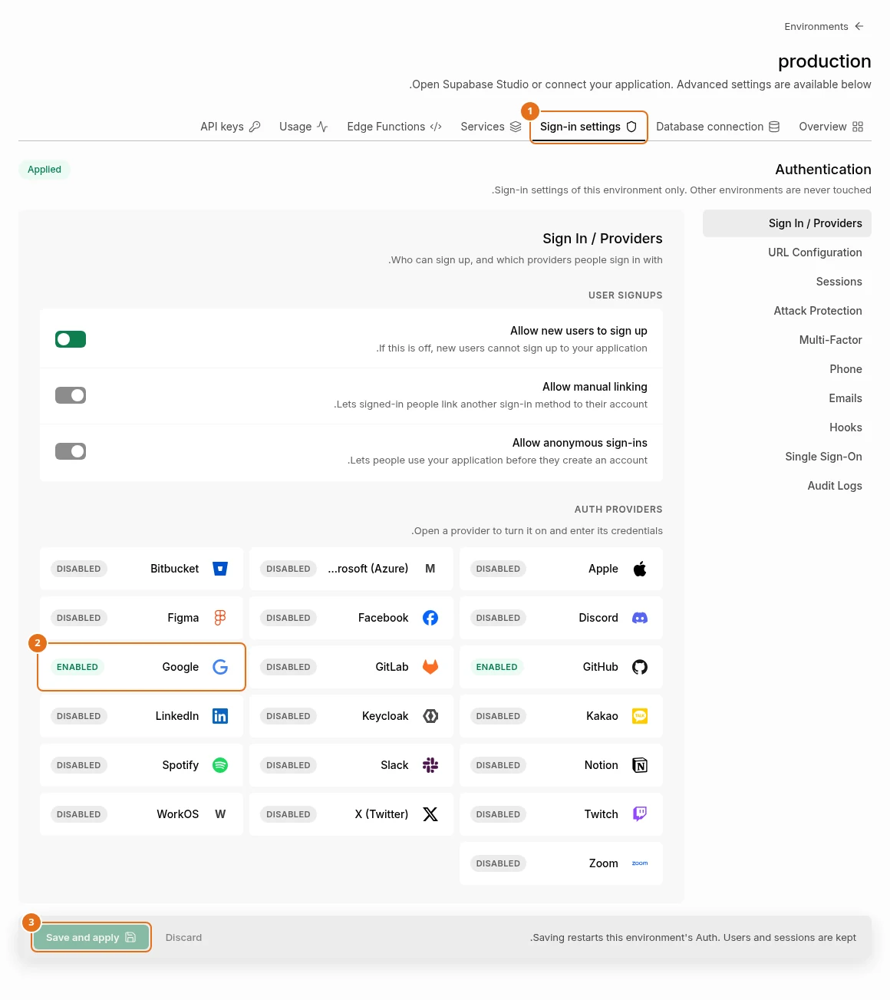

*Demo data. The text is English and the layout is mirrored.*

## Checklist

- Public address set, so callback and email links are not `http://localhost`.
- Site URL and a narrow list of redirect URLs.
- Each provider: callback copied out, client ID and secret pasted in, **Save and apply**, then one real sign-in.
- Custom SMTP with a test sign-up, **Confirm email** left on.
- Any hook: function created and granted before it is turned on.
- The chip says **Applied**.
