[العربية](console-tour.ar.md)

# Console tour

One page, every place in an environment, and when to use it. The screenshots come from the console's test pages with example data, not from a real installation, and every caption says so. A number on a screenshot marks what to click.

Start at **Projects**, open a project, then press **Connection details** on an environment. The environment page has seven sections in a row under its name. Owners and admins see all seven; viewers see **Overview**, **Usage** and **API keys**.

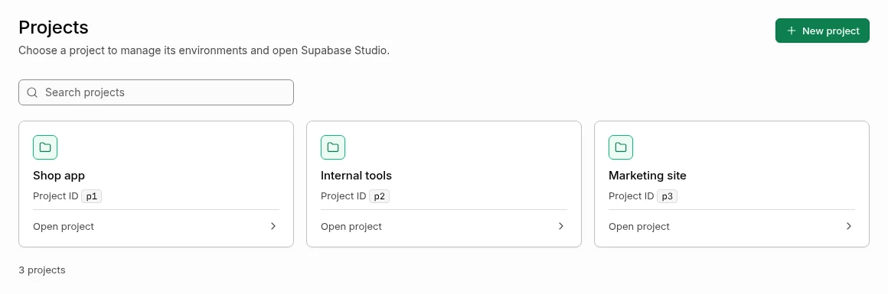

*Demo data. Projects are the first page after you sign in.*

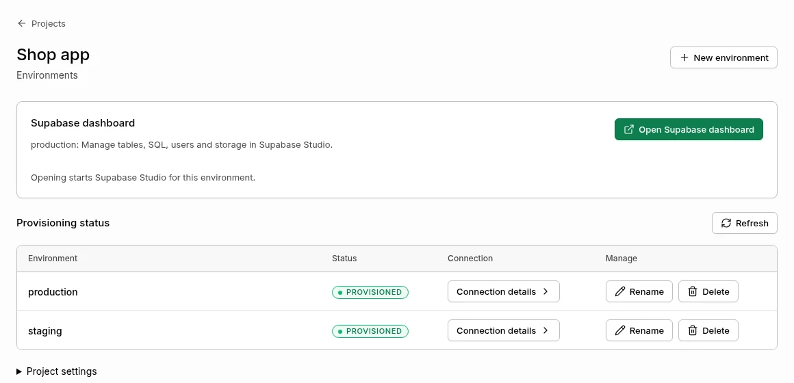

*Demo data. Each environment has its own database, Auth and REST. Connection details opens the environment page.*

## Overview

Use it first. It has the button that opens Supabase Studio for this environment, the **Project URL** to paste into your app (with a copy button), and the state of the environment's email.

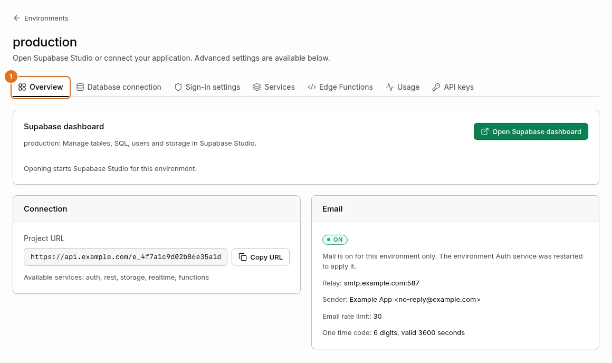

*Demo data.*

## Database connection

Use it to run migrations or connect with `psql`, Prisma or Drizzle. It shows the connection string (the password is shown once when you make a new one), turns direct database access on or off, and has **External access** for services that cannot use an SSH tunnel. More in [Database access](database-access.md).

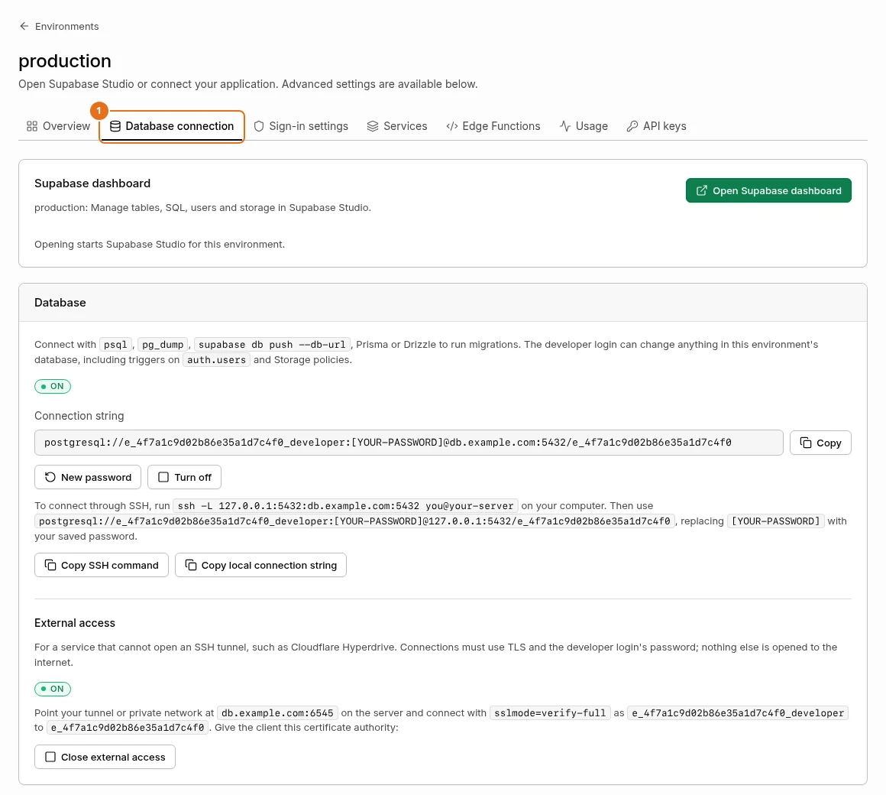

*Demo data. The password placeholder is never a real password.*

## Sign-in settings

Use it for everything about who can sign in and how: providers, URLs, sessions, emails, phone, hooks, single sign-on and audit logs. Below it, the **Signing key** card rotates the key Auth signs sessions with ([Signing keys](signing-keys.md)). The full walkthrough is [Authentication in the console](authentication.md).

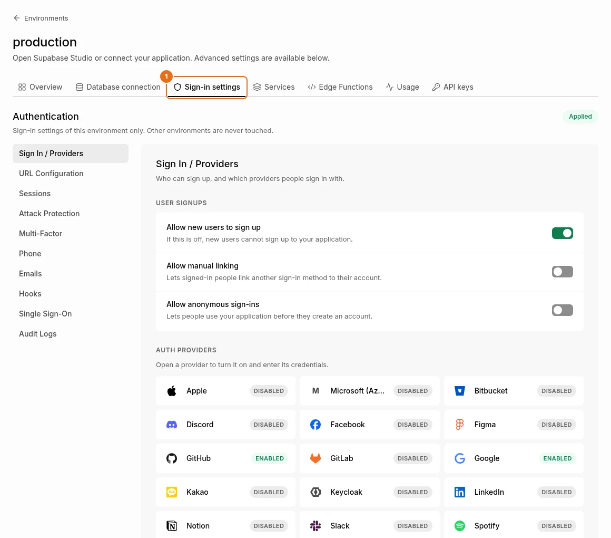

*Demo data.*

## Services

Use it to turn **Realtime** and **Scheduled jobs** on or off for this environment. Each runs as its own small service only while it is on ([Realtime](realtime.md), [Scheduled jobs](scheduled-jobs.md)).

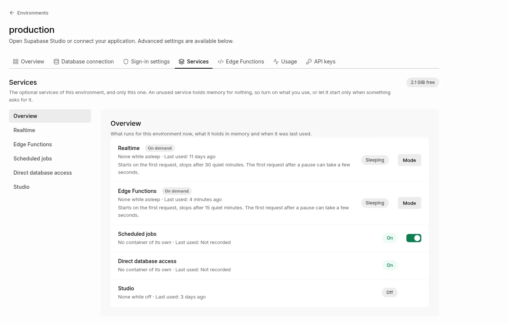

*Demo data.*

## Edge Functions

Use it to deploy, edit, test and watch your own Deno code. It has a function list, a code editor with a deploy check, secrets, settings, logs and usage ([Edge Functions](edge-functions.md)).

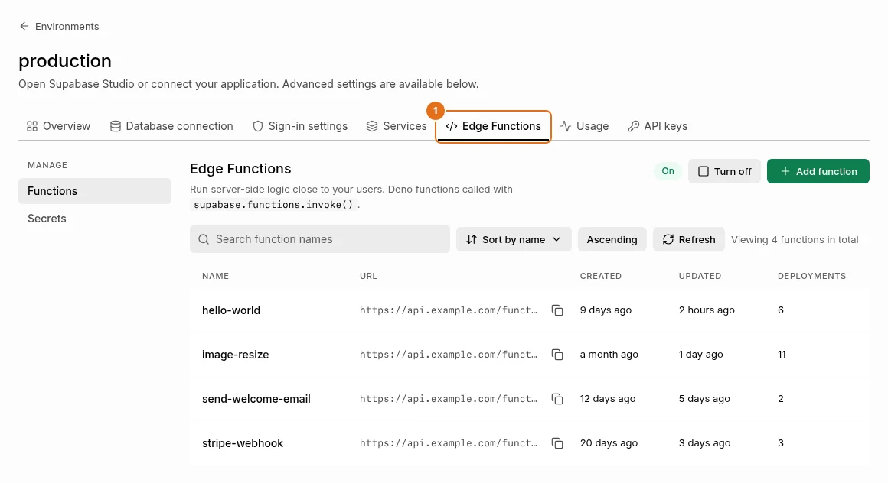

*Demo data.*

## Usage

Use it when something is slow or failing. It shows the **Gateway share** (how many requests this environment can run at once), requests, error rates and response times for the last hour, memory and processor of each service, and the latest requests or service logs ([Logs and metrics](logs-and-metrics.md)).

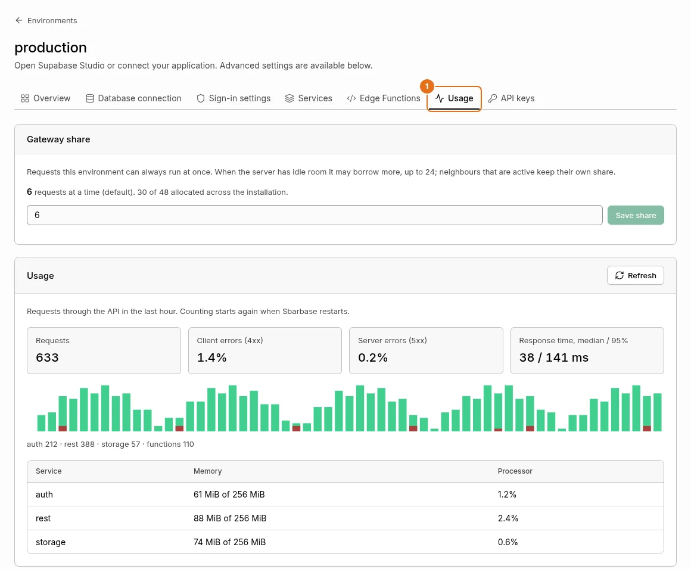

*Demo data.*

## API keys

Use it to make and revoke the publishable key your app ships with and the secret keys for servers and CI. A secret key is shown once when you make it ([API keys](api-keys.md)).

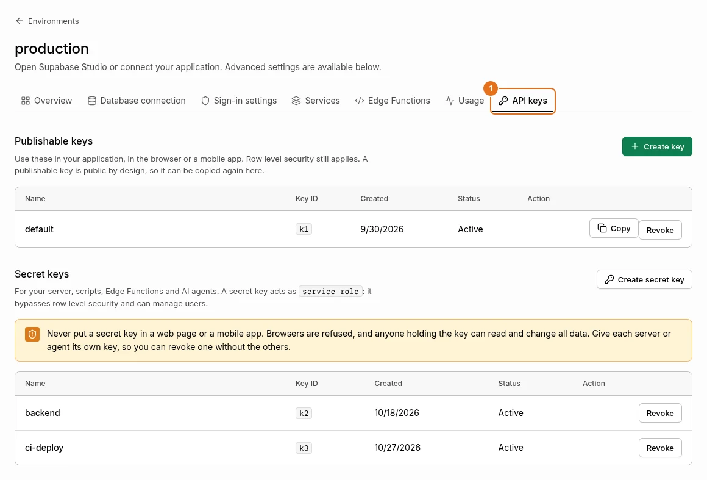

*Demo data. The secret keys show no key value; it was shown once, when the key was made.*

## Dark theme

The console follows the system theme, and the sidebar has a theme button.

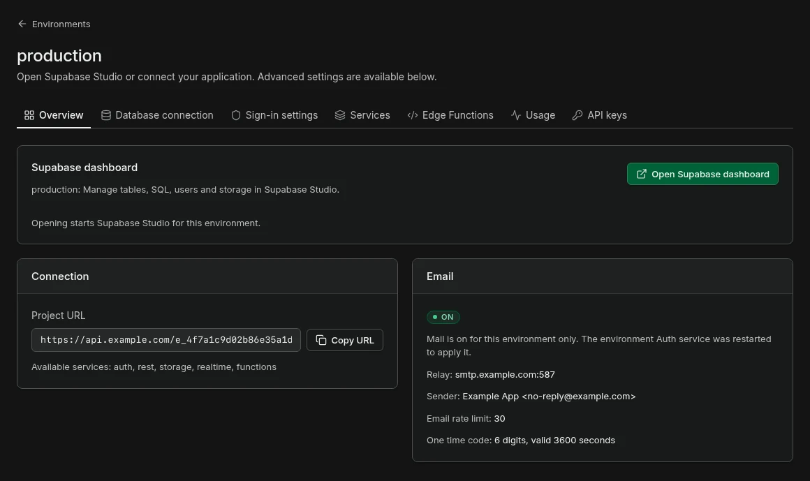

*Demo data.*

## Right to left

The console's text is English only for now and does not switch to Arabic by itself, but its layout is built to mirror.

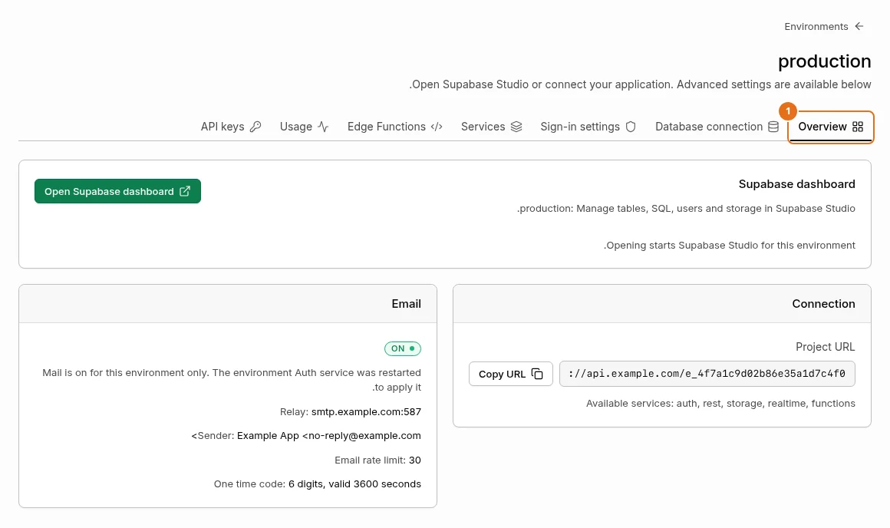

*Demo data. The text is English and the layout is mirrored.*

## Next

- New here: [Quickstart](quickstart.md).
- Sign-in for your app: [Authentication in the console](authentication.md).
- Server code: [Edge Functions](edge-functions.md).
