[English](edge-functions.md)

# Edge Functions

تشغّل Edge Functions كود Deno الخاص بك بجانب البيئة، وتُستدعى عبر `supabase.functions.invoke()` على `<address>/functions/v1/<name>`، كما في Supabase. لكل بيئة بيئة تشغيل خاصة بها، هي edge-runtime الأصلي، وتبدأ مع أول نشر.

## الأوضاع: Off وOn وOn demand

تبدأ البيئة الجديدة بـ Edge Functions في وضع **On demand**: لا حاوية ما دام أحد لا يستدعي دالة، ويشغّلها أول استدعاء، وتتوقف بعد 15 دقيقة هدوء (تغيّر ذلك من صفحة [Services](services.ar.md)). والاستدعاء الأول بعد توقف ينتظر نحو ثانيتين؛ وإن رُفض البدء أو تأخر يحصل على `503` مع `retry-after`، وتنجح إعادة المحاولة. اختر **On** لإبقائها تعمل طوال الوقت، أو **Off** لإيقافها. ونشر دالة يشغّل Edge Functions فقط إذا كانت **Off**؛ ويقول الجواب `turned_on`، والبيئة المحفوظة على On demand لا يغيّرها النشر أبدًا. واستدعاء بلا مفتاح API يستطيع تشغيل طبقة تشغيل نائمة لدالة عامة فقط (`verify_jwt` مطفأ). وفي [لماذا كان طلبي الأول بطيئًا؟](services.ar.md) التفاصيل.

## النشر من مشروع Supabase

إن كانت لديك دوال في مشروع Supabase، فانشر مجلد `supabase/functions` كله بأمر واحد من نسخة من مستودع صباربيز:

```bash
SBARBASE_EMAIL=you@example.com bun lab/functions-deploy.ts https://console.example.com <environment id> ../my-app/supabase/functions
```

- يطلب كلمة مرور المشغّل (أو يقرؤها من `SBARBASE_PASSWORD`) ولا يطبعها أبدًا.
- كل مجلد فيه `index.ts` يصبح دالة؛ واذكر أسماء بعد المجلد لتنشر بعضها فقط.
- يُنشر `_shared` بجانب كل دالة، فيعمل `import { corsHeaders } from '../_shared/cors.ts'` دون تغيير.
- يُحترم `verify_jwt = false` تحت `[functions.<name>]` في `supabase/config.toml`، كما في Supabase CLI.
- تعمل استيرادات `npm:` و`jsr:` والروابط: بيئة التشغيل تصل إلى الإنترنت.

معرّف البيئة موجود في صفحتها في لوحة الإدارة. إعادة النشر تُطبَّق فورًا دون إعادة تشغيل، والطلب الجاري ينتهي على الإصدار الذي بدأ به.

## النشر عبر Supabase CLI أو وكيل

برمز وصول شخصي (`sbp_...`) ينشر Supabase CLI إلى هذا الخادم عبر ملف تعريف (profile)، بالأمر `supabase --profile ./sbarbase-profile.yaml functions deploy <name> --project-ref <ref> --use-api`، ويضبط الأسرار بالأمر `secrets set`. ووكيل الذكاء الاصطناعي المتصل بنقطة `/mcp` على الخادم ينشر بأداته `deploy_edge_function`. تجد ملف التعريف والرمز والخطوات في [وكلاء الذكاء الاصطناعي](agents.ar.md).

## صفحة Edge Functions

يفتح المالك والمدير **Edge Functions** من صفحة البيئة. فيها صفحتان على نمط سحابة Supabase: **Functions** و**Secrets**.

تعرض **Functions** كل دالة مع عنوانها (وزر نسخ) ووقت إنشائها وآخر نشر وعدد مرات النشر. ابحث بالاسم، ورتّب بالاسم أو وقت الإنشاء أو وقت التحديث، وحدّث القائمة. يبيّن المفتاح في أعلى الصفحة حالة بيئة التشغيل: Off أو Applying أو On أو Not applied، ويشغّلها أو يوقفها. يفتح **Add function** محررًا يبدأ من قالب (Hello world أو Webhook أو Read with supabase-js أو Browser calls with CORS، وهذا الأخير يعرض أيضًا ملفًا مشتركًا)، أو يقدّم أمر النشر لمجلد مشروع، وهو الطريق لمجلد `supabase/functions` كاملًا مع `config.toml`.

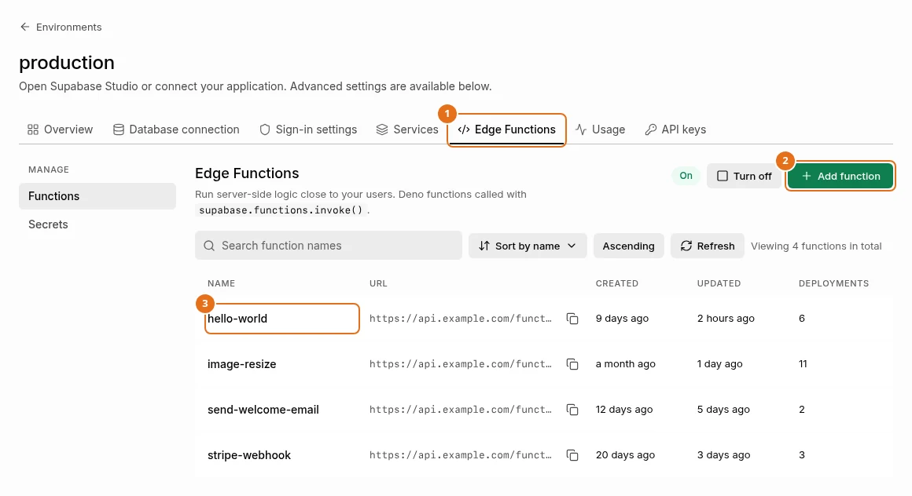

*بيانات تجريبية. البحث والترتيب وRefresh فوق القائمة، والمفتاح في الأعلى يبيّن حالة طبقة التشغيل.*

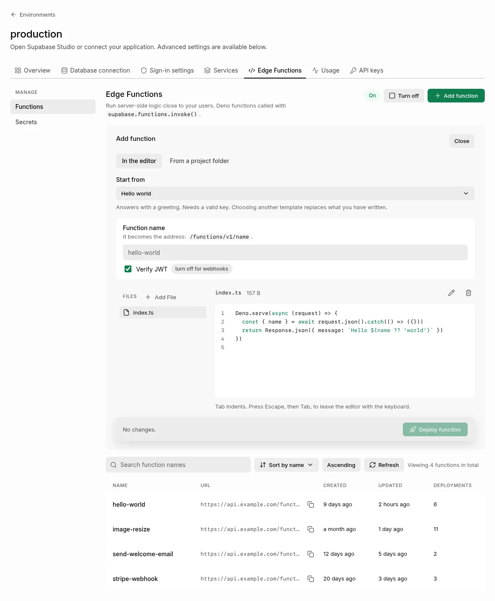

*بيانات تجريبية. اختر قالبًا وسمِّ الدالة ثم انشرها.*

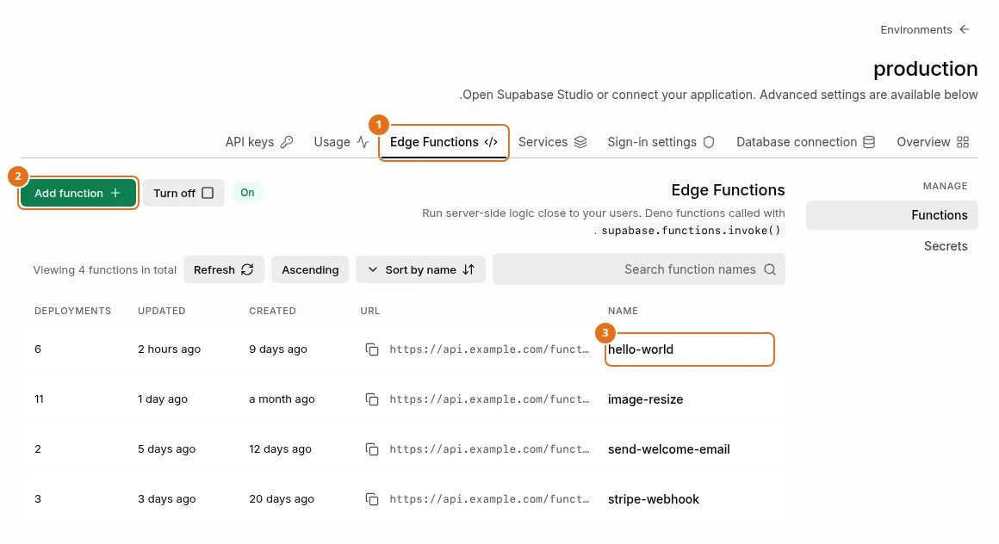

*بيانات تجريبية. واجهة لوحة الإدارة بالإنجليزية فقط الآن؛ تُظهر اللقطة أن التخطيط ينعكس حين تُعرض الصفحة من اليمين إلى اليسار.*

افتح دالة لترى تبويباتها. يظهر **Download** و**Test** في أعلى كل تبويب.

- **Overview.** اختر 15 min أو 1 hour أو 3 hours أو 1 day: عدد الاستدعاءات، ونسبة 5xx ونسبة 4xx مع رسم، والأخطاء منذ آخر نشر، ومتوسط زمن الرد وأطوله. تعدّ بوابة صباربيز هذه الأرقام في الذاكرة، يومًا من الدقائق لكل دالة، وتبدأ من جديد عند إعادة تشغيل صباربيز؛ وتذكر الصفحة منذ متى بدأ العدّ. الزمن هو حتى تبدأ الدالة بالرد، لا حتى ينتهي رد متدفق. وتحت **Usage**: متوسط زمن المعالج لدى العامل وأطوله، ومتوسط ذاكرته، ونسبة ما يحمله من هذه الذاكرة كومةً (heap) وذاكرة خارجية (external)، مع رسمين بالأعمدة. تأتي من العامل المراقب (event worker) في بيئة التشغيل، ويبلغ العامل عند إسقاطه، أي بعد دقيقة تقريبًا من آخر استدعاء له (75 ثانية في القياس الوحيد)، فالدالة التي تُستدعى اليوم كله على عامل واحد لا تُظهر شيئًا حتى ينتهي ذلك العامل. كل رقم لعمر العامل كله لا لاستدعاء واحد، والذاكرة هي ما حمله العامل عند انتهائه لا ذروته. وإن كانت بيئة التشغيل مطفأة أو بدأت قبل هذا الإصدار فيقول القسم ذلك؛ وتحصل على العامل المراقب عند أول تشغيل لـ Edge Functions بعد ذلك. وتُحسب الاستدعاءات المرسلة من **Test** أيضًا.

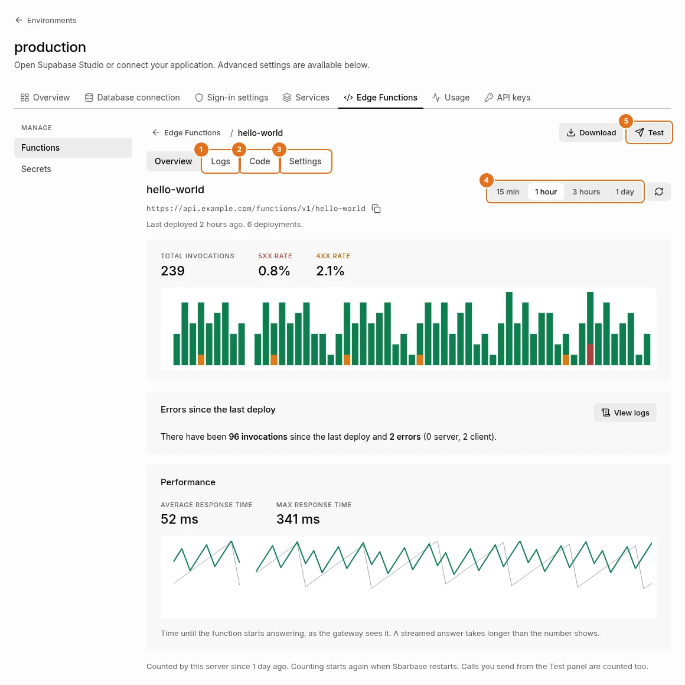

*بيانات تجريبية. الاستدعاءات مع نسبتي 5xx و4xx، والأخطاء منذ آخر نشر، وزمن الاستجابة.*

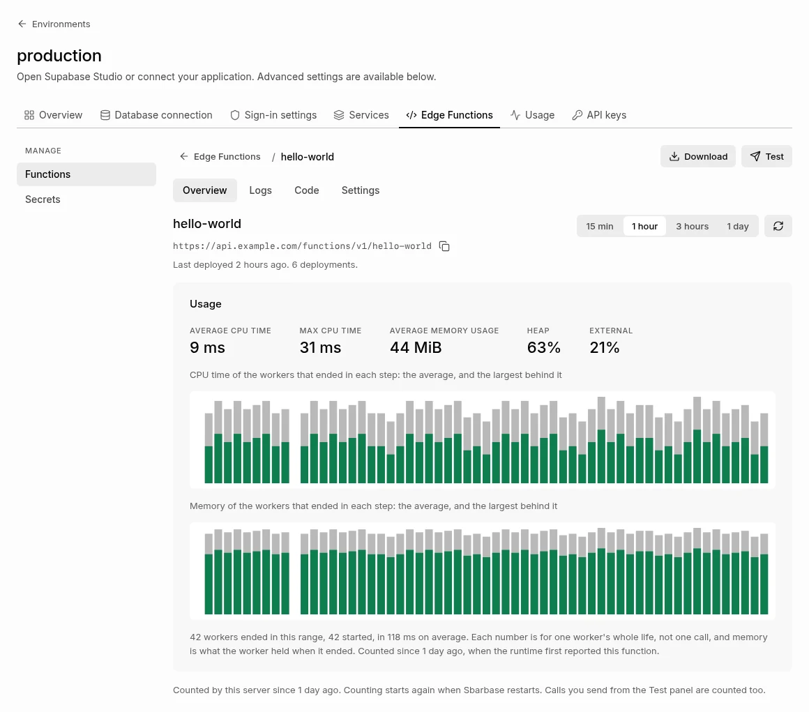

*بيانات تجريبية. يظهر Usage بعد أن يبلّغ عامل الأحداث في طبقة التشغيل عن عامل انتهى.*
- **Logs.** استدعاءات هذه الدالة التي عدّتها البوابة في المدى الزمني الذي تختاره (من 15 دقيقة إلى يوم، وساعة في البداية)، من آخر 200 استدعاء تحتفظ بها: الوقت والطريقة والمسار والحالة والزمن المستغرق. لا يُحفظ نص الاستعلام (query string) أبدًا، ويُخفى جزء المسار الذي يشبه رمزًا سريًّا. رشّح بنص، أو أظهر الأخطاء فقط، أو شغّل **Live**. وتحتها **Output of** هذه الدالة: ما كتبته بـ `console.log` و`console.error` مع مستواه، كما يبلّغه العامل المراقب (آخر 200 سطر منذ بدء بيئة التشغيل، وكل سطر مقصوص عند 1000 حرف؛ وتنطبق المرشحات نفسها، وتُخفى المفاتيح والرموز وكلمات المرور وقيم أسرار هذه البيئة إن بلغت ستة أحرف فأكثر). وإن كانت بيئة التشغيل مطفأة أو بلا عامل مراقب بعد فتعرض الصفحة سطور البيئة كلها وتقول ذلك.

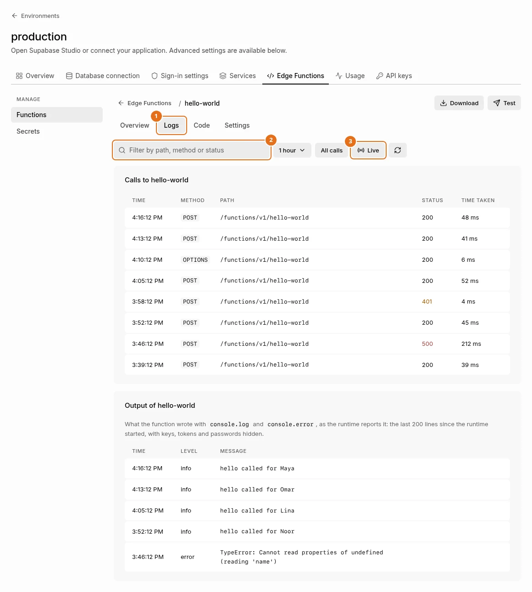

*بيانات تجريبية. الاستدعاءات في الأعلى، وما كتبته الدالة بـ console.log وconsole.error تحتها.*
- **Code.** ملفات الإصدار العامل شجرةً، والكود المشترك تحت `../_shared`، في محرر فيه أرقام أسطر وألوان. ينشئ **Add File** ملفًا (سمِّ الملف المشترك `../_shared/name.ts`)، ويعيد القلم تسمية الملف المفتوح، وتحذفه سلة المهملات. يضيف Tab مسافتين، ويزيح السطور المحددة؛ واضغط Escape ثم Tab لتخرج من المحرر بلوحة المفاتيح. يرسل **Deploy updates** كل الملفات إصدارًا جديدًا. وإن كانت بيئة التشغيل تعمل فتُسأل أن تشغّل الإصدار الجديد أولًا، والإصدار الذي لا تستطيع تشغيله (خطأ نحوي أو استيراد لا تجده) يُرفض برسالتها هي، ويبقى الإصدار العامل. والنشر بلا نقطة دخول index (`index.ts` أو `index.js`) يُرفض قبل ذلك بالرمز `400`. لا يستدعي الفحص معالج الدالة، لكن الكود في أعلى الملف يُنفَّذ مرة واحدة أثناء بدء العامل (بصلاحيات استدعاء، وبلا متغيرات، وبحد أقصى 15 ثانية): الخطأ المرمي في أعلى الملف، أو ملف لا يستدعي `Deno.serve`، يمرّان ويظهران عند أول استدعاء أو في سجل بيئة التشغيل. وإن كانت Edge Functions مطفأة أو قيد التطبيق أو غير مطبّقة فلا يُفحص النشر، وتقول الصفحة ذلك؛ وإن لم تجب بيئة التشغيل خلال 20 ثانية فيمضي النشر ويقول إنه لم يُفحص. والدالة التي فيها ملف يتجاوز 256 KiB، أو أكثر من 2 MiB في المجموع، تُفتح للقراءة فقط: نزّلها (**Download**)، أو انشر من جديد من مجلد المشروع. والخروج من المحرر وفيه تغييرات يسأل أولًا، من تبويب أو سهم الرجوع أو قائمة البيئة أو زر Environments؛ أما الشريط الجانبي للوحة والمسار في أعلاها فلا يسألان، وإعادة تحميل الصفحة تسأل.

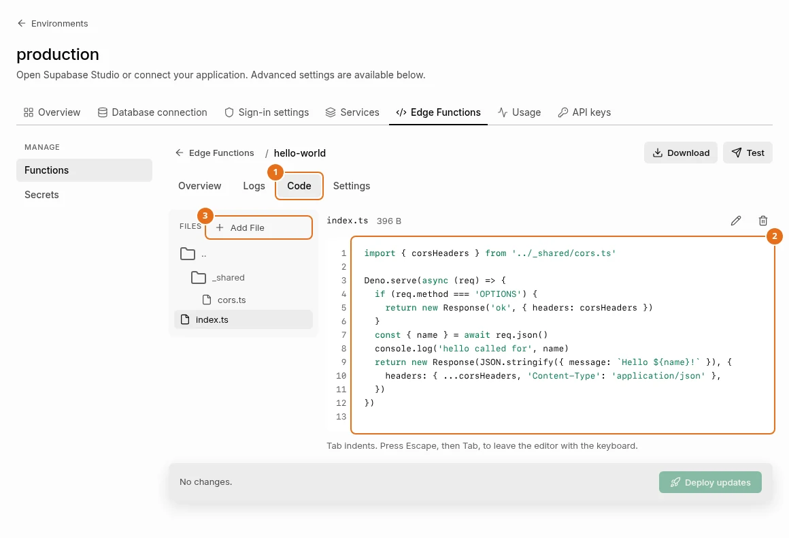

*بيانات تجريبية. ملفات الإصدار العامل، والكود المشترك تحت ../_shared.*

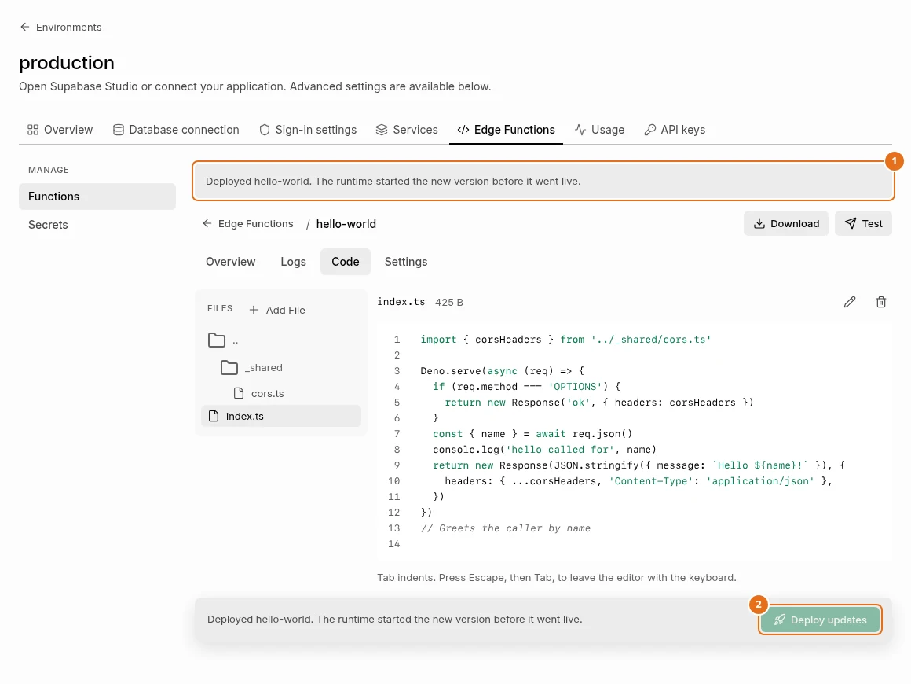

*بيانات تجريبية. في اللقطة ينجح فحص النشر. الإصدار الذي لا تستطيع طبقة التشغيل تشغيله يُرفض برسالتها هي ويبقى الإصدار العامل.*
- **Settings.** **Verify JWT** مفتاحًا مع **Save changes** (يسري عند الاستدعاء التالي ولا ينشئ إصدارًا جديدًا)، وكيف تستدعي الدالة من cURL وJavaScript وSwift وFlutter وPython بمفتاح بديل (يضع **Show publishable key** مفتاح هذه البيئة في المثال)، وأمر النشر، و**Delete function** الذي يطلب منك كتابة اسم الدالة.

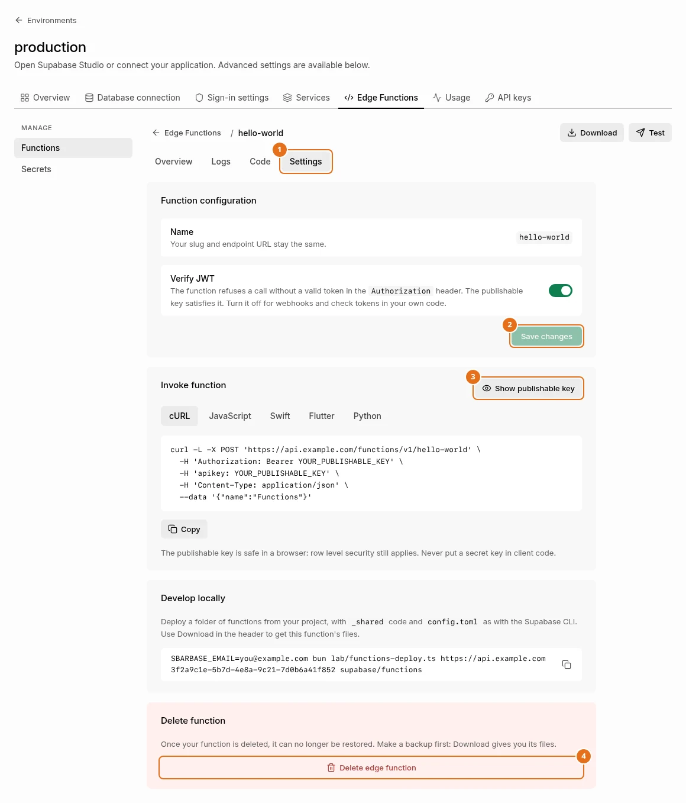

*بيانات تجريبية. المفتاح المعروض قيمة نائبة إلى أن تضغط Show publishable key.*
- **Test.** يرسل طلبًا واحدًا من متصفحك بالمفتاح العام لهذه البيئة: الطريقة ومتن الطلب والرؤوس ومعاملات الاستعلام. يعرض الحالة والزمن ومتن الرد. ولا يسمح المتصفح للصفحة بقراءة إلا رؤوس الرد التي تكشفها البوابة، فقائمة الرؤوس قصيرة.
- **Download.** ملف ZIP مرتّب كمشروع: `<name>/index.ts` و`_shared/...`.

تضيف **Secrets** أسرارًا أو تستبدلها، لكل سر صفّ (يجوز أن تمتد القيمة على عدة أسطر؛ ويضيف **Add another** صفًّا؛ ولصق أسطر `NAME=value` كما في ملف `.env` في حقل الاسم يصنع صفًّا لكل سطر)، وتسرد الأسرار المخصصة مع بصمة (digest) ووقت ضبط كل منها، وتحذف أيًّا منها، وتسرد الأسرار الافتراضية. لا تظهر القيمة مرة أخرى. البصمة HMAC-SHA256 بمفتاح تملكه هذه البيئة، فتبيّن إن كانت القيمة قد تغيّرت، وتعطي القيمة نفسها بصمةً مختلفة في بيئة أخرى، ولا يمكن تخمين سر قصير منها دون هذا المفتاح. وهي ليست SHA256 العادية التي قد تعرضها سحابة Supabase. السر المحفوظ قبل وجود هذه الصفحة يظهر وقته مجهولًا.

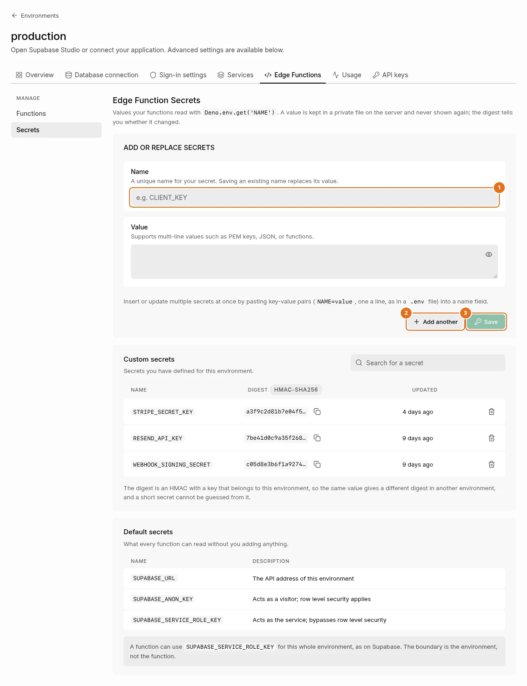

*بيانات تجريبية. لا تُعرض القيم بعد حفظها؛ والبصمة تدلّ على تغيّر القيمة فقط.*

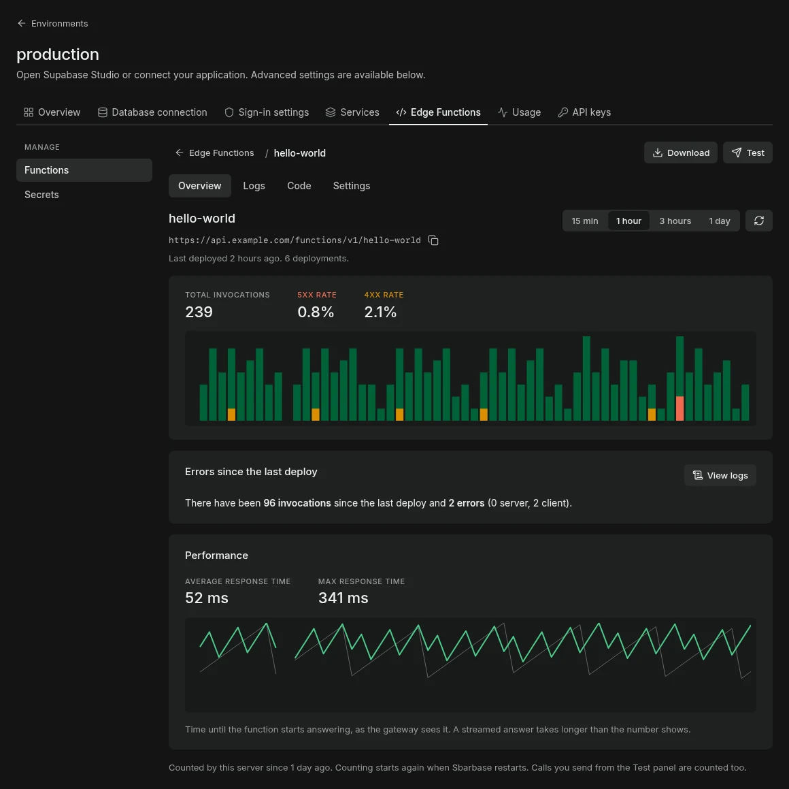

*بيانات تجريبية. تتبع لوحة الإدارة مظهر النظام.*

النشر الذي لا تستطيع بيئة التشغيل تشغيله يُرفض بالرمز `422` من `PUT /management/v1/environments/{id}/functions/{name}` مع رسالتها؛ ويعرضها `lab/functions-deploy.ts` ومسار النشر المتوافق مع Supabase. وطلب `PATCH` على المسار نفسه يأخذ `{"verify_jwt": true}` أو `false`.

## استدعاء دالة

```js
const { data, error } = await supabase.functions.invoke('hello-world', { body: { name: 'Sbarbase' } })
```

تحصل كل دالة على هذه المتغيرات، كما في Supabase:

| المتغير | ما هو |
|---|---|
| `SUPABASE_URL` | واجهة هذه البيئة، لاستدعاء `createClient()` داخل الدالة |
| `SUPABASE_ANON_KEY` | يعمل كزائر، ويطبَّق أمان الصفوف |
| `SUPABASE_SERVICE_ROLE_KEY` | يعمل كالخدمة نفسها ويتجاوز أمان الصفوف. أبقِه داخل الدوال |

أضف متغيراتك في صفحة **Secrets** (مثل `STRIPE_SECRET_KEY`) واقرأها بـ `Deno.env.get('STRIPE_SECRET_KEY')`. لا تظهر القيمة مرة أخرى بعد حفظها.

## من يستطيع استدعاء دالة

- تحتاج الدالة افتراضيًا رمز JWT صالحًا: المفتاح العام (يرسله supabase-js)، أو [مفتاح سري](api-keys.ar.md) من خادم تتلقاه الدالة رمزَ `service_role`، أو رمز مستخدم مسجّل الدخول. المفتاح الخاطئ يُرفض قبل أن تعمل الدالة.
- الدالة المنشورة مع إطفاء **Require a valid JWT** (`verify_jwt = false`) تقبل أيضًا الاستدعاء دون أي مفتاح، لخطاف ويب من مزوّد دفع أو خدمة أخرى. عندها تتحقق الدالة من الاستدعاء بنفسها، مثلًا بترويسة التوقيع من المزوّد، التي تصلها كما هي.

## كيف تعمل

- بيئة تشغيل واحدة لكل بيئة، حدها 384 MiB ونصف معالج؛ وتعمل كل دالة في عامل خاص بها حده 150 MiB، ويتوقف بعد 150 ثانية. يستطيع العامل أن يكتب ملفات مؤقتة تحت `/tmp`، لكن `/tmp` مساحة واحدة حجمها 32 MiB تشترك فيها كل دوال البيئة؛ والكتابة بعدها تفشل، ولا تعتمد على بقاء الملفات بعد انتهاء الاستدعاء. ولا يستطيع قراءة ملفات أخرى، لا ملفات بيئة التشغيل ولا ملفات دالة غيره.
- حاوية بيئة التشغيل مقفلة: بلا صلاحيات لينكس إضافية، وبلا ترقية في الامتيازات، وجذر نظام الملفات للقراءة فقط، ومستخدم غير مميّز. وتُحتسب استدعاءات الدوال في **Usage** كما تُحتسب الخدمات الأخرى.
- لا ترى الدالة إلا كود بيئتها وأسرارها. ولبيئة التشغيل شبكة داخلية خاصة بها، لا تضم إلا Auth وREST الخاصتين بهذه البيئة؛ وخدمات البيئات الأخرى ليست عليها. أما الملفات فتمر عبر Sbarbase، وهو يطلب من Storage المشترك ملفات هذه البيئة دائمًا، مهما كان ما تطلبه الدالة. ولم يُتحقق من هذا الفصل على تثبيت يعمل بعد ([التفاصيل](../engineering/FUNCTIONS-NETWORK-ISOLATION.md)). وما زال بإمكان الدالة فتح اتصالات بالإنترنت، وبالخادم وبالشبكات الخاصة أيضًا إلى أن تُطبَّق قواعد جدار الحماية في [النشر على خادم](server-deployment.ar.md#حدّ-ما-تصل-إليه-edge-functions). تُولَّد هذه القواعد لك، وتراجعها أنت، وتطبّقها أنت؛ ولم يُجرَّب تطبيقها على خادم حقيقي بعد.
- استدعاءات كل دالة في تبويب **Logs** فيها؛ ومخرجات بيئة التشغيل للبيئة كلها تحت **Usage** ثم **Logs**، المصدر **Edge Functions**، بجانب الخدمات الأخرى.
- تصل الدوال إلى Storage عبر المنفذ 25433 على الخادم. وإذا كان جدار الحماية يُسقط الاتصالات الواردة افتراضيًا (كما يفعل ufw)، فأضف القاعدة الموصوفة في [النشر على خادم](server-deployment.md#firewall-two-routes-from-containers-to-the-host).
- تعرض صفحة Edge Functions في Studio الكود المنشور لكل دالة ([Studio](studio.ar.md)).
- زر **Turn off Edge Functions** يوقف بيئة التشغيل ويُبقي الكود؛ والتشغيل أو النشر من جديد يعيدها.

ينشر CI مجلد دوال بالأمر أعلاه على جهاز نظيف مع كل تغيير، ويستدعي الدوال عبر البوابة باستخدام supabase-js، ومنها دالة تستخدم supabase-js من npm بصلاحية الخدمة ([الدليل](../evidence/docker-functions-checks.json)).

## الحدود

- في البيئة الواحدة 100 دالة على الأكثر.
- ما يبلّغه العامل المراقب محفوظ في الذاكرة داخل حاوية Functions للبيئة (يومًا من الدقائق و200 سطر لكل دالة من 100 على الأكثر)، ويبدأ فارغًا مع بدء تلك الحاوية. ويحتفظ العامل بحتى 1000 حدث حين تتأخر بيئة التشغيل في الرد ويُسقط الأقدم، فالدالة التي تكتب في حلقة قد تزيح أرقام غيرها. وأي دالة تقرأ، بمفتاح service role الذي تحمله، أرقام كل دوال بيئتها وسطورها؛ فالحد الفاصل هو البيئة.
- تحتفظ عملية صباربيز الواحدة بأرقام كل دالة في الذاكرة (يومًا من الدقائق، وحتى 40,000 عدّاد دقيقة للبيئة، وتُحذف الأقدم أولًا)، فتفرّغها إعادة التشغيل، وعملية صباربيز ثانية تعدّ لنفسها. وحذف بيئة لا يحذف حتى الآن أسرار دوالها ولا ملفات البصمة؛ وملفات الأسرار تتصرف هكذا أصلًا.
- يرسل المحرر الدالة كاملة لا أجزاءَ منها. وإن حرّر شخصان الدالة نفسها معًا فيبقى آخر نشر.
- الكود ملفات نصية، حتى 500 ملف و10 MiB في كل نشر. يُحفظ الكود المنشور في `.lab/upstream/functions/` وليس في النسخ الاحتياطية للبيئة بعد: احتفظ بمجلد مشروعك.
- لا يُعطى `SUPABASE_DB_URL`؛ صِل إلى قاعدة البيانات عبر `SUPABASE_URL`.
- لا يعمل الأمر `supabase functions deploy` إلا مع `--use-api` وملف تعريف صباربيز ([وكلاء الذكاء الاصطناعي](agents.md#the-supabase-cli))؛ فبدون `--use-api` يحزم CLI الدوال عبر Docker ويرفع صيغة لا يقرؤها هذا الخادم.
- جسم الطلب أو الرد يمر عبر البوابة حتى حد الرفع (`SBARBASE_UPLOAD_LIMIT_MB`).
- لا يعمل في البيئة أكثر من 4 استدعاءات للدوال في وقت واحد؛ والاستدعاء التالي يُجاب بالرمز `429` مع `retry-after: 1` حتى ينتهي أحدها. ويحتفظ REST وAuth في البيئة نفسها بحصتهما. والدالة التي أُطفئ فيها **Require a valid JWT** تقبل الاستدعاء دون مفتاح، فيستطيع كل من يصل إلى العنوان أن يملأ هذه الأماكن الأربعة في تلك البيئة. ولا يوجد حد لكل مستدعٍ بعد.
- لبيئة التشغيل 384 MiB لكل العوامل. أربعة عوامل مشغولة، حد كل منها 150 MiB، لا تتسع لها، وإذا نفدت ذاكرة الحاوية توقفت وبقيت متوقفة، ومعها كل دوال البيئة، حتى النشر التالي أو حتى تُطفئ Edge Functions وتشغّلها من جديد. واستهلاك الذاكرة مع عدة دوال مشغولة معًا لم يُقَس.
- جُرّبت بيئة التشغيل المقفلة على محطة عمل لينكس واحدة بـ Docker يعمل بصلاحيات root. ولم يُجرَّب ما يلي: حزم npm ذات الإضافات الأصلية (native addons)، وقد تمنع المساحات المؤقتة بلا تنفيذ (`noexec`) تحميلها، وDocker بلا صلاحيات root، ونطاق مستخدمين معاد التعيين، وSELinux في وضع الإلزام، ومضيف يسمح للحاوية بـ swap، وأنظمة أخرى.
- الـ 32 MiB من `/tmp` تشترك فيها كل دوال البيئة، وتُحتسب من ذاكرة بيئة التشغيل. وذاكرة التخزين المؤقت لاستيرادات `npm:` و`jsr:` والروابط مساحة منفصلة حجمها 32 MiB (استعملت supabase-js وzod وms معًا 16 MiB)؛ فإن تجاوزت استيراداتك هذا الحجم فشلت الاستيرادات اللاحقة حتى تُعاد حاوية بيئة التشغيل.
- منع الدالة من الوصول إلى عنوان البيانات الوصفية للسحابة (metadata) طبقة أولى فقط: تغطي هذا العنوان ومعظم صيغ كتابته، ويتجاوزها الشكل العشري المجرد وشكل NAT64 وأي اسم مضيف يُحلّ إلى هذا العنوان. والحدّ الحقيقي هو قواعد جدار الحماية على الخادم المذكورة أعلاه.
