[العربية](services.ar.md)

# Services

The **Services** page of an environment lists the optional services that cost memory or a login while they are on: [Realtime](realtime.md), [Edge Functions](edge-functions.md), [Scheduled jobs](scheduled-jobs.md), [direct database access](database-access.md) and Studio. Each environment has its own; turning one on or off never touches another environment.

## What the page shows

For every service, the **Overview** shows:

- **State:** **Off**, **Starting…**, **On**, **Stopping…**, **Sleeping** and **Waking…** (for a service in On demand mode, see below) or **Not applied** (with the reason in words, for example that the server has no room for another Realtime).
- **Memory now:** what the service's container holds, next to its ceiling, for example `183 MiB of 320 MiB`. Services with no container of their own (scheduled jobs, direct database access) say so.
- **Last used:** when a Realtime connection was last open or closed, and when an Edge Functions call last arrived carrying a valid API key (a preflight or a call with no key does not count, since anyone can send those). Studio shows its own last use. Scheduled jobs and direct database access do not record one, and the page says **Not recorded** instead of guessing.

Open a service in the side list for the same facts in one place, its mode or switch, and what turning it on costs: a sentence such as "Turning it on needs about 320 MiB. This server has about 2.1 GiB of memory available now and keeps a reserve, so it can still say no." The available memory comes from the server itself; the start itself is admitted against the server's ceilings and reserve, as always.

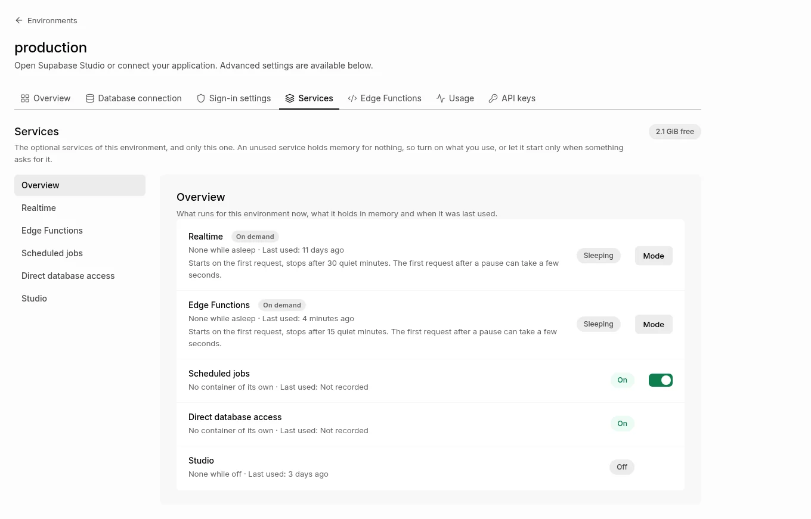

*Demo data.*

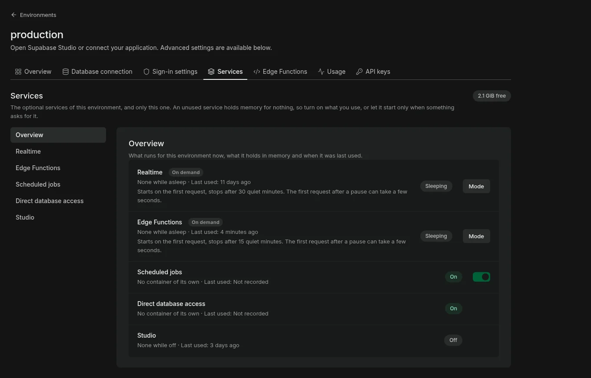

*Demo data.*

## Who can use it

Every member of the client can read the page. Only owners and admins can change a service. Realtime and Edge Functions have a **mode**; Scheduled jobs has a switch; direct database access and Studio keep their own pages, and the page links to them.

If a service has open connections (Realtime) or running calls (Edge Functions), turning it off first asks you to confirm and says how many there are. The page asks about what is open right now, not about what it showed a minute ago. Turning Edge Functions off waits up to 10 seconds for the running calls to finish, and new calls are asked to retry meanwhile; Realtime's open connections close, and clients reconnect when it is on again.

## The three modes

Realtime and Edge Functions each have one of three modes, chosen per environment on the page (**Off**, **On**, **On demand**). The page says what a choice does before you apply it.

- **Off.** No container runs and nothing starts it. Requests to the service fail as they do for a service that was never turned on. Deployed functions and their secrets are kept.
- **On.** The container runs all the time and holds its memory (up to 320 MiB for Realtime, 384 MiB for Edge Functions) whether anything uses it or not. This is what turning a service on always did.
- **On demand.** No container while nothing uses the service. **Starts on the first request, stops after N quiet minutes. The first request after a pause can take a few seconds.** That sentence is shown under the service on the page.

The state of an On demand service is **Sleeping** (no container, by design), **Waking…** (a request just asked for it), **On** or **Not applied** (a start was refused, with the reason in words). Sleeping is not a failure and is never shown in red.

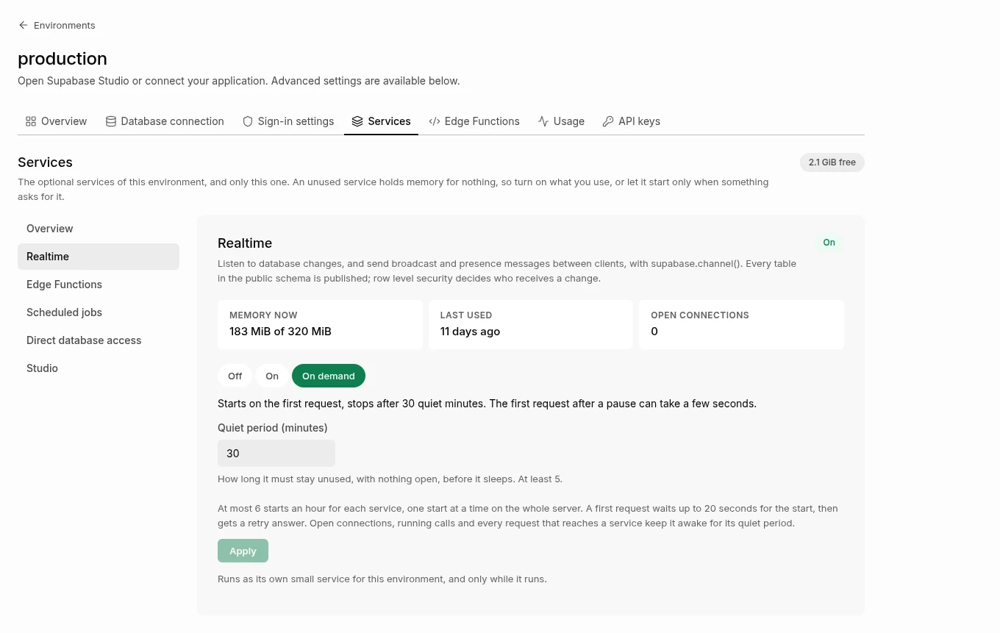

*Demo data. Realtime shown as On demand only because an operator allowed it.*

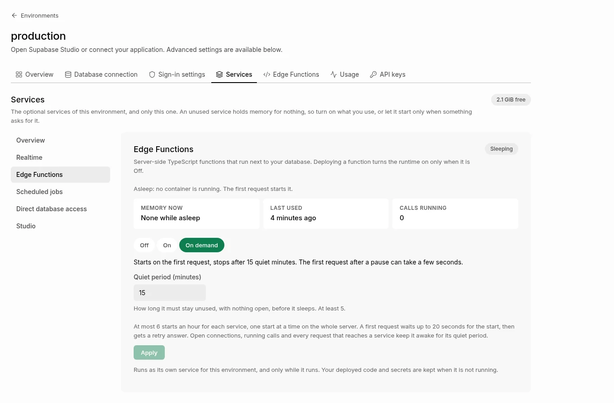

*Demo data.*

## Why Edge Functions are On demand by default, and Realtime is not

A new environment starts with Edge Functions **On demand** and Realtime **Off**. The choice rests on a measurement: a sleeping service must start fast enough that the first request waits without a visible failure. On a developer workstation (five runs each, [evidence](../evidence/optional-services-2026-10-30/README.md)) Edge Functions answered a call again 1.9 to 2.5 seconds after the wake, so On demand is safe as the default. Realtime took 12.3 to 14.8 seconds, almost all of it the upstream Realtime's own start, more than the 10 seconds supabase-js gives a channel to join. So Realtime stays Off for a new environment, and On demand for Realtime cannot be chosen unless an installation operator allows it (**Settings of the installation**, below), for a server where it starts faster. Environments that already exist keep what they have: an environment with a service **On** stays **On**, and the Services page offers **On demand** as a choice with its exact effect in words ("It keeps running now, and stops by itself once it has been quiet that long with nothing open").

## The first request after a pause

When a request reaches a sleeping service, the gateway first checks its API key. Only then does it start the service, and it holds the request while it starts, up to 20 seconds.

- **Edge Functions.** The call is held for about two seconds and then answered normally. If the start takes longer than 20 seconds, or the server has no room for it, the call gets `503` with a `retry-after` header and a sentence saying why; the next call succeeds once the service is up. `supabase.functions.invoke()` does not retry by itself, so an app that must never fail on the first call after a long pause retries a `503` once after the number of seconds in `retry-after`, or keeps the service On.
- **Realtime (when allowed).** A socket is held while Realtime starts. supabase-js reconnects on its own, so a slow start is a delayed first message at worst; a broadcast sent over HTTP is held the same way.
- **A call without an API key** (a payment provider's webhook, for example) can start Edge Functions only if the function is public: deployed with `verify_jwt` off, which its owner chose. A call without a key to any other function never starts anything.

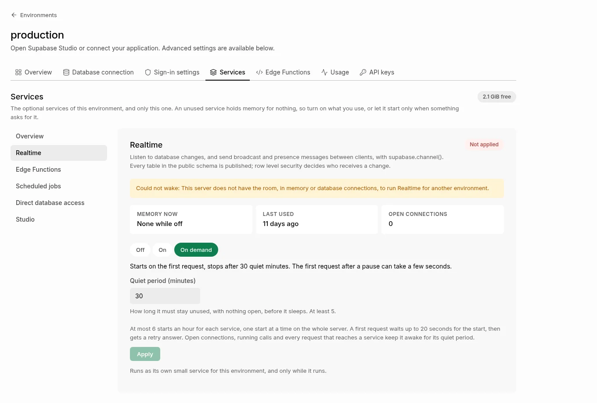

*Demo data.*

## Why was my first request slow?

If the first call or connection after a quiet spell took a few seconds, the service was asleep and your request started it: this is On demand working, not a fault. Look at the Services page: it shows **Sleeping** for such a service, and the mode **On demand** with its quiet period. The same request after that is fast, and stays fast until the service has been quiet for its whole period. To avoid the delay, keep the service always on (next section), or shorten the pause between uses to less than the quiet period.

## Keep a service always on

Choose **On** for that service on its Services page (or send `{"mode": "on"}` to `PUT /environments/{id}/functions` or `/realtime`). It then runs all the time, as before, and never sleeps. An operator can also keep **every** On demand service on at once with the kill switch (below), without changing anyone's saved choice.

## What each timer means

- **Quiet period** (per service and environment; 15 minutes for Edge Functions and 30 for Realtime at first; never below 5 minutes). How long a service must stay unused, with no open connection and no running call, before it sleeps. Any request that reaches it starts the count again. You change it on the Services page; the installation's defaults are set by an operator.
- **Hold** (20 seconds, shown read only). How long a first request waits for the service to start before it gets `503` with `retry-after`.
- **Wake limit** (6 an hour for each service and environment, shown read only). A key an app carries in public could otherwise start the service again and again. Beyond the limit the answer is `429` with a clear message; the service stays up while it is used, so the limit is only reached by a service that keeps going to sleep between calls (a quiet period of 5 minutes with calls every 8 to 10 minutes, for example): keep it On.
- **One start at a time** on the whole installation, and every wake goes through the same check of memory and database connections as turning the service on by hand. If there is no room, the request gets `503` and the page shows the reason.
- **Unused days** (7, at least 1). Only for a service that is On: how long it may sit unused before the page and the operator are told. Nothing is turned off by it.

## What is never stopped

A service sleeps only after its whole quiet period with **no open WebSocket (Realtime) and no call in flight (Edge Functions)**; an open connection keeps Realtime awake however long it lasts. A request that arrives while the stop is waiting for the supervisor cancels the stop. A service that is woken counts as used from that moment, so it is never put to sleep before the request that woke it is served. A restart, an update, a backup or a restore never starts a sleeping or Off service: they start only what the published endpoints name, and a sleeping service has none.

Realtime's replication slot does not outlive the container: a sleep removes Realtime's slots of the environment (checked afterwards, so no WAL is held while it sleeps), and Realtime creates its slot again when a client joins after the wake. The live check proves both ([evidence](../evidence/optional-services-2026-10-30/README.md)).

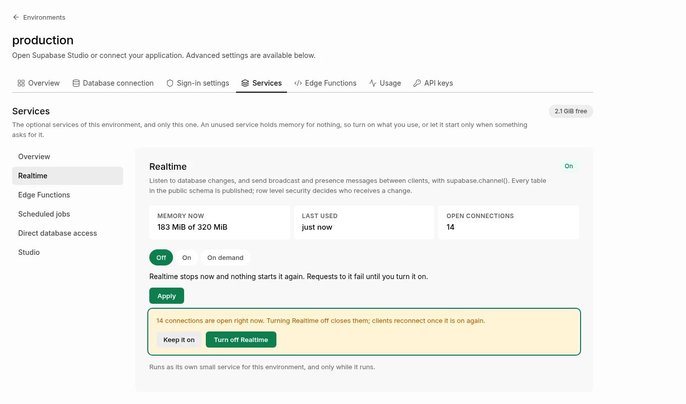

*Demo data.*

## Settings of the installation

Operators change the defaults without touching code or the host, on **Server**, under **Optional services**: the **kill switch** (every On demand service behaves as On while it is set; sleeping services start one at a time and nothing goes to sleep; saved choices are untouched, so turning it off puts them back to sleeping on their own), what a **new environment** starts with, the default quiet periods, whether **Realtime may be On demand**, and the days before an unused service is reported. The same settings are `GET` and `PUT /management/v1/installation/services` (`killSwitch`, `defaultMode`, `realtimeOnDemand`, `idleMinutes`, `unusedDays`), for installation operators only. Every change, every wake and every sleep is an audit event with the actor (`system:wake`, `system:idle`, `system:kill-switch` for the automatic ones) and the reason (`user`, `wake`, `idle`, `kill_switch`, `capacity`, `default`).

The old body `{"enabled": true}` or `{"enabled": false}` still works for every client: it means **On** or **Off**, and so it replaces an On demand choice. Deploying a function turns Edge Functions on only when they are Off; the answer says `turned_on`, and an environment saved as On demand is never changed by a deploy.

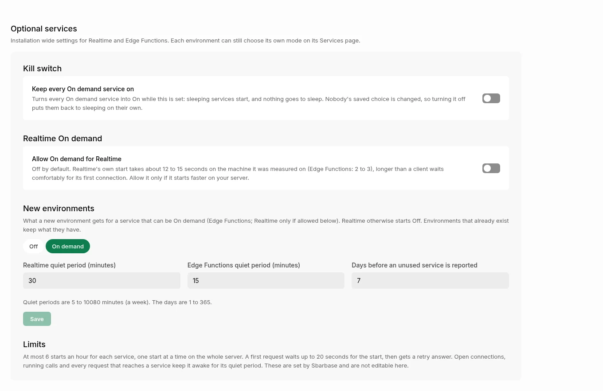

*Demo data.*

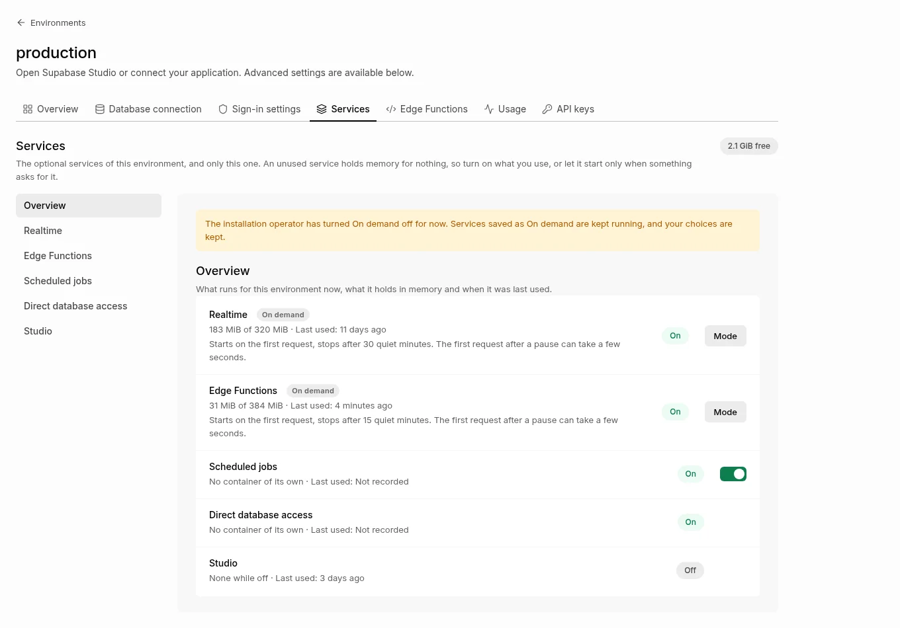

*Demo data.*

## Room on this server, and the build cache

Operators see, on **Server**, under **Room on this server**, what a new environment or service can still get, against the limits the supervisor itself enforces (the page reads them from the supervisor once a minute; it never keeps its own copy): memory is **Too low** where a new environment would be refused (less than the 2 GiB the server keeps in reserve plus the environment's own 512 MiB, so about 2.5 GiB must be available), **Getting low** when there is room for only one more environment, and each disk Sbarbase writes to (the one it is installed on, and Docker's when that is another one, where the build cache lives) is a warning below 5 GiB or 10% free and critical below 2 GiB or 5%, the same lines that raise the operator notice. Realtime and Edge Functions pass their own check of memory and database connections as well, which the page does not predict. A sample older than 15 minutes shows **Not known yet**, never a stale verdict. The page also says plainly whether the host has swap: with none, a container that passes its memory ceiling is stopped, not slowed down, and Sbarbase's own containers have swap switched off either way.

**Docker build cache.** The page shows the size of Docker's build cache (read every ten minutes, with when) and a button, **Clear build cache**, which asks the supervisor to run one `docker builder prune --force`. That is the only thing it can remove: images, containers and volumes are never touched, and the way back of an update needs the images, so they stay. The button asks first, says how much it can free at most (the prune removes the cache nothing uses, and the figure is Docker's own estimate), and afterwards says how much it freed, or that it failed and that nothing else was touched. `GET /management/v1/server/capacity` and `POST /management/v1/server/build-cache` are for installation operators only; the request is an audit event with the actor.

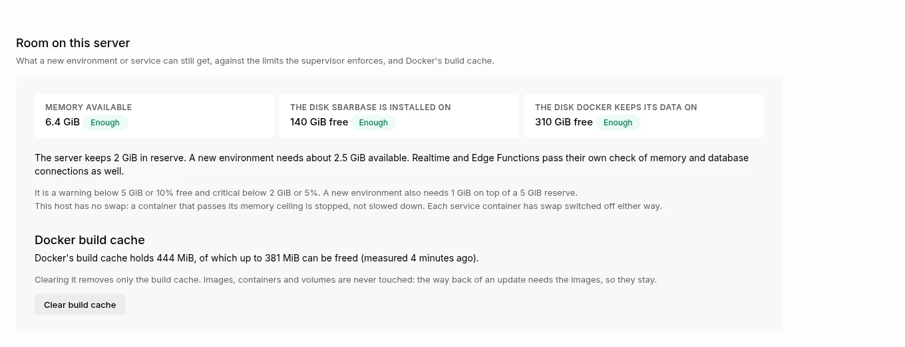

*Demo data.*

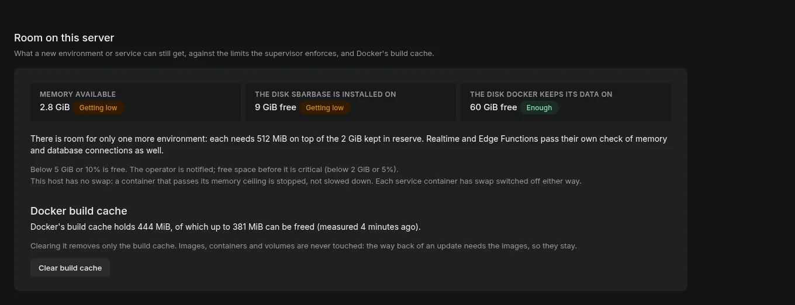

*Demo data.*

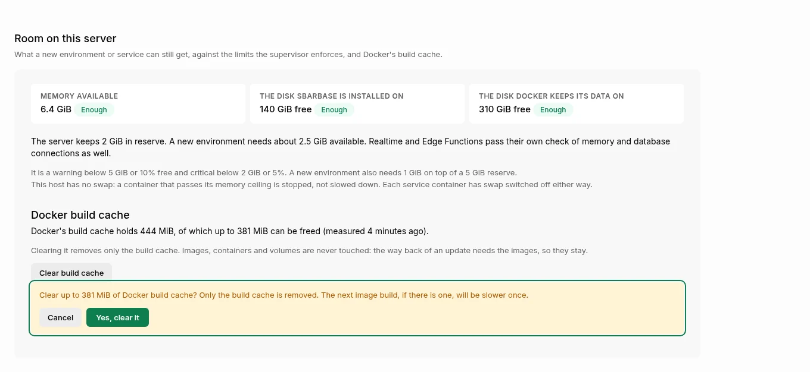

*Demo data.*

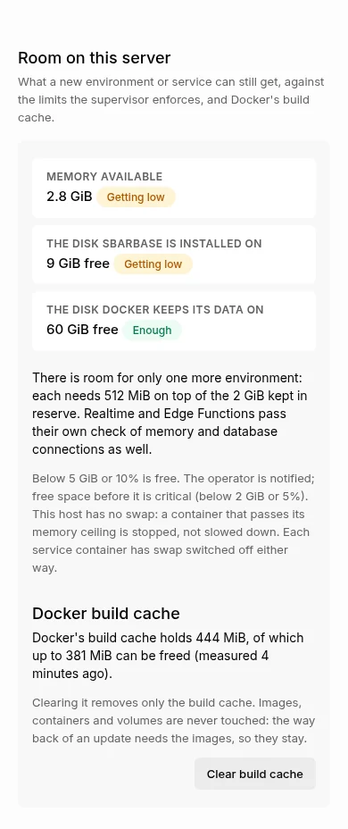

*Demo data.*

## Hints for services nobody uses

When Realtime or Edge Functions has been on for 7 days with no use, its row says so under its name, to every member (only owners and admins get the button): "No connection for 11 days, 183 MiB. Turn it off?", with a button that asks the same way the switch does. The clock starts at the later of the last use and the time you turned it on, so a service you switched on yesterday is never called unused. Nothing is ever turned off by a hint.

The operator of the installation gets one notice per service (through the [notification channels](../engineering/OPERATOR-NOTIFICATIONS.md)), repeated at most every 14 days. The 7 days is a setting with a floor of 1 day: `GET` and `PUT /management/v1/installation/services` with `{"unusedDays": 3}`, for installation operators only. Each change is an audit event with the actor and the old and new value.

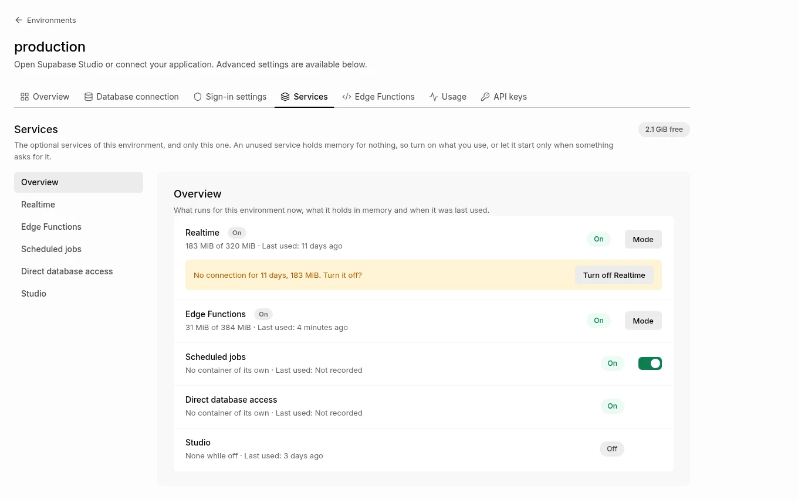

*Demo data.*

## How the memory is measured

The supervisor reads the containers' memory once a minute and writes one small private file that the console reads (`lab/service_stats.py`); the console process never touches the Docker socket. A figure older than three minutes is shown as out of date, never as current. The page asks again every few seconds while a service is starting or stopping.

## Limits

- On demand needs the service to start in seconds: see the measured numbers above. On a slow or loaded server a first request can wait the full 20 seconds and then be told to retry.
- The wake limit, the hold and the kill switch are per installation and per process of the console; the numbers shown are what the gateway enforces.
- The wake, sleep and counts of open connections are kept by the console process that serves requests; during a handover each process counts its own.
- Not measured: a real server, a loaded host, and many environments waking together (they start one at a time).
- A deploy checks that a new version starts only while Edge Functions are running (`boot_check` says `skipped` otherwise): for an On demand environment that is asleep, the first call after the deploy is the first run of the new version.
- The memory and last-used figures come from this server's own counters. A restart of the console starts the in-memory part again; the last-used time itself is kept in the catalog.

The page reads the same right to left and on a phone.

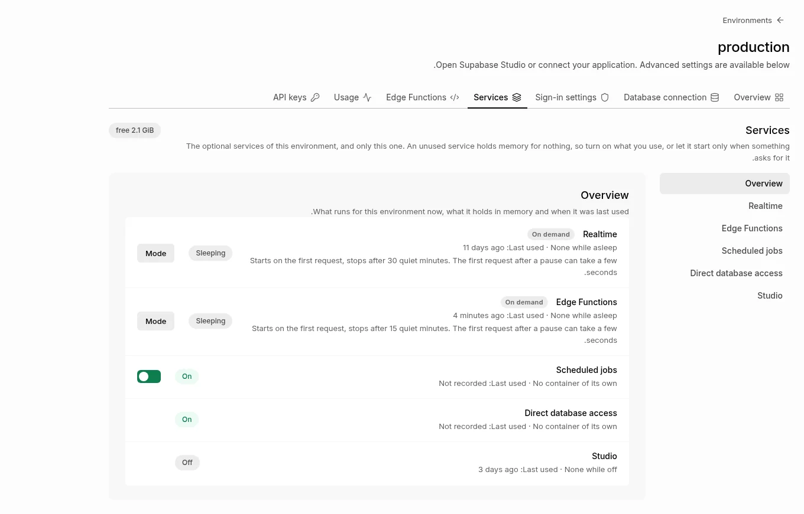

*Demo data.*

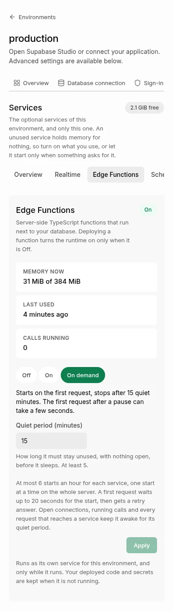

*Demo data.*
